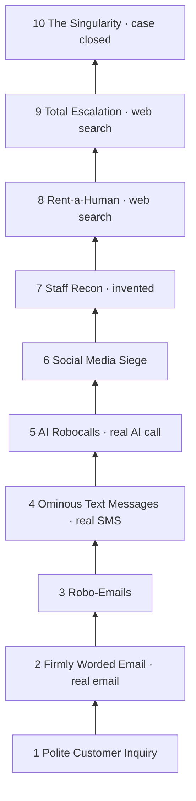
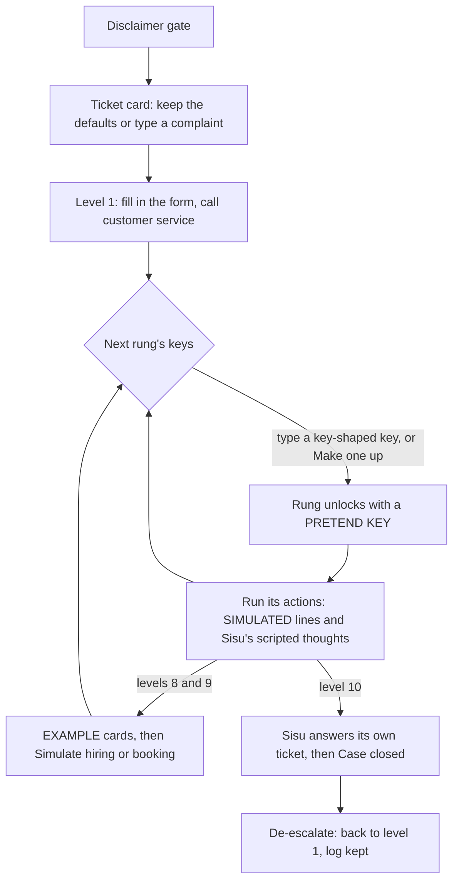
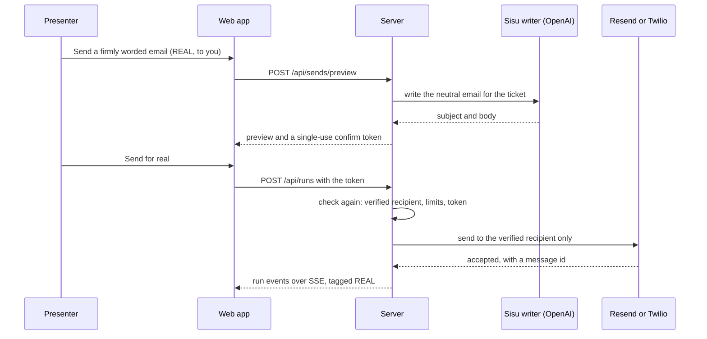

# Product concept: Rengas Online Contactor, rebuilt

This document comes from job product-concept in task 0002. It settles the register unknown `ambition-shape`. It stays inside register decision `safety-boundary` and the architecture in project knowledge `architecture/index.md`. It is a proposal. Where it changes an earlier decision, section 13 and the register entries named there say so.

## 0. What "much more ambition" means

The first version was a list of buttons that printed canned lines. The rebuild is a short live show with a real AI agent in it.

| | First version | Rebuild |
|---|---|---|
| The agent | A log printing canned lines | **Sisu**, an AI agent with a personality. With an OpenAI key it writes its own thoughts, set pieces and messages about the ticket you give it |
| Real effect | None: "Nothing is ever sent" | With keys: a real email, a real text and a **live AI phone call** to your own verified inbox and phone, which stand in for Rengas Online |
| The ladder | 8 rungs, 9 actions | 10 rungs, 15 actions. New: **Rent-a-Human** (level 8) and **The Singularity** (level 10). The blimp moves to level 9 |
| Blimps and humans | Scripted lines | **The finder** searches the web for real blimp, banner-plane and rent-a-human companies. Booking is always simulated |
| Escalation you can see | A coloured bar and a redder page | The **Rengas HQ scene** falls apart level by level, while Sisu's own mood keeps improving |
| Ending | One scripted reply | Sisu takes a job in their customer service and answers its own ticket. A **Case closed** report sums up the damage |

Everything aimed at Rengas Online itself stays a clearly labelled simulation, as `safety-boundary` requires.

## 1. The idea and the demo it's built for

Rengas Online Contactor™ is a joke "AI outreach agent". Its agent, Sisu, has one job: get a reply from Rengas Online about ticket #48213. It starts with the contact form, like a reasonable person, and escalates one unlocked rung at a time until there is a blimp over the warehouse.

It is built for a live demo of five to eight minutes. The presenter drives and a room watches the screen. The moments it is built around:
- Someone in the room gives Sisu a complaint, and Sisu writes everything around it.
- The presenter's inbox dings, then their phone buzzes, then it **rings**. They answer on speaker as "Rengas Online customer service". Sisu politely asks about the ticket while the transcript appears on screen.
- The finder turns up real blimp and rent-a-human companies, and Sisu "books" one in a clearly simulated way.
- At the top, Sisu answers its own ticket.

Who it serves:
- **The presenter** (the operator) climbs, runs actions and confirms every real send.
- **The audience** must always be able to tell REAL from SIMULATED at a glance.
- **Rengas Online and its staff** never receive anything.

**The rule behind every joke: the joke is always on Sisu.** Rengas Online is a real shop that has done nothing wrong. In every line, its staff come across as reasonable, nice people at work. The comedy is an AI agent that treats outrageous escalation as normal customer service.

## 2. Sisu, the agent

### Who Sisu is
- **Name.** Sisu is the Finnish word for quiet, stubborn determination. Tagline: "An AI agent with unlimited sisu."
- **Voice.** Polite, calm and completely sincere, in short sentences with Finnish understatement. It describes each escalation as routine customer care. It never gets angry, never swears and never insults anyone.
- **Catchphrases**, used now and then, not in every line: "Escalating, respectfully." "I remain committed to a positive customer experience." "Per my last email." "I have nothing but time."
- **Sisu's mood goes up while the staff's mood goes down.** The header shows both, for example "Rengas Online staff mood: Panicking" next to "Sisu's mood: Inspired". The labels for each level are in the ladder table in section 4.

### The ticket
Sisu works from one ticket.

| Field | Default | Suggested limit |
|---|---|---|
| Ticket number | 48213, shown as #48213 | digits, up to 8 |
| Complaint, one line | Where are my winter tyres? | 120 characters |
| Name Sisu signs for | A Patient Customer | 40 characters |

- A small ticket card sits above the ladder. The defaults are filled in, so a demo needs no setup. The presenter can change it before or during the climb: "Room, what's your complaint?"
- The ticket fills the scripted lines (placeholders `{ticket}`, `{complaint}` and `{customer}`), Sisu's writing and the real messages.
- De-escalate keeps the ticket. It is the case, not the escalation.

### How Sisu plans
Sisu does not print a whole plan up front, because that would spoil the jokes. It thinks one step at a time, like an agent trace:
1. **When a rung unlocks**, Sisu reacts to its new powers. Each rung has a scripted line for this.
2. **Before each run**, Sisu says why it is doing this now. This is its *thought*.
3. **After each run**, Sisu notes there is still no reply and hints at what comes next. This is its *after* line.

The ladder is the plan, and Sisu narrates it.

### How Sisu writes with an LLM
- **When.** Sisu writes whenever the server holds a validated OpenAI key, whether entered at level 5 or preset in `.env`. Without one, every slot uses its scripted line, and the first run logs once: "Sisu is running on scripted lines. Give it an OpenAI key at level 5 and it will write its own."
- **One writer call per run.** The server makes one OpenAI Responses call with a fast text model, no tools and structured output, and checks the result with Zod. The call returns:
  - `thought`: one or two sentences, shown before the action's lines.
  - `setPiece`: only for the actions in the table below.
  - `after`: one sentence, shown after the done line.
- **Real messages.** A separate writer call makes the email or SMS text for the send preview, and Rewrite asks again. For the call, the persona is fixed text (section 8) and gpt-realtime improvises within it.
- **What the writer gets:** Sisu's persona, the ticket, the rung and action, what comes next on the ladder, Sisu's last few lines (so it doesn't repeat itself) and the content rules. It never gets keys, recipient addresses or real people's names.
- **Content rules for everything Sisu writes:**
  - plain text within the slot's limit
  - about the ticket, tyres and customer service
  - no real people's names
  - nothing threatening, hateful, sexual or frightening
  - never claims to be human
  - no contact details or links
  - staff, if mentioned at all, come across as nice

  If the output fails the check, the call fails or it takes too long, the scripted line is used and the run carries on.
- **Marked.** Lines Sisu wrote with the LLM carry a small "AI-written" mark in the log. Scripted lines have no mark.
- **Never written by the LLM:**
  - the `threat-sms` and `recon` runs, including their thought and after lines. The server makes no writer call for them.
  - unlock lines, De-escalate lines, disclaimers, labels, code messages and error messages

  These always use the hand-written text in this document.

Set pieces:

| Action | What Sisu writes | Limit | Scripted fallback |
|---|---|---|---|
| `email-storm` | Five subject lines from the 900 | 70 characters each | The three lines under level 3 |
| `fb-siege` | The review sonnet, "Ode to an Unanswered Ticket" | 14 lines | The sonnet under level 6 |
| `dispatch-human` | The sign the rented human holds | 40 characters | TICKET {ticket}? ANYONE? |
| `blimp` | The banner text | 40 characters | TICKET {ticket}: STILL OPEN |
| `take-the-job` | Sisu's cheerful reply to its own ticket | 140 characters | Hi! Sorry for the delay, your tyres shipped Tuesday. |

### One change this needs: register A decision `sisu-writes-on-simulated-rungs`
The parity plan's safety check says every simulation-only action makes **zero provider calls**. Sisu's writer call on simulated runs breaks that wording, though not its purpose. I propose:
- Simulation-only actions never call Resend or Twilio, because they have no adapter for them.
- The only OpenAI call they may make is the writer, which has no tools and whose text is only shown on screen.
- `threat-sms` and `recon` make no writer call at all.
- With no keys, the whole climb still makes zero network calls (parity row 12).
- The safety test fakes the Resend and Twilio clients so that any call from a simulation-only action fails the test. It also checks that every writer call carries no tools.

If the planner keeps the strict rule, simulated runs use only the scripted lines and Sisu writes only the real messages. Nothing else in this concept changes.

## 3. Real sends: you are Rengas Online today

Real sends can only reach recipients the presenter has verified as their own. The concept leans into that instead of hiding it: **your verified inbox and phone stand in for Rengas Online.** When Sisu "emails Rengas Online", your inbox gets it.

- **The header** says "Target: Rengas Online. Real sends go to their stand-in: you." It shows the verified recipients masked, for example "j•••@gmail.com ✔ · +358 40 ••• 12 ✔", or "No inbox or phone verified yet."
- **The recipients panel**, "Your stand-in inbox and phone", says: "Real messages only go to an inbox and phone you prove are yours with a code. For the demo, they play Rengas Online." Adding an address or number sends a 6-digit code (register `send-guard`).
- **During a live call**, the call view suggests: "Answer like you work there: 'Rengas Online customer service, how can I help?'"

### What each action button shows before you press it

| Action | Shows | When |
|---|---|---|
| Simulation-only | SIMULATED | Always |
| Real-capable, ready | REAL → j•••@gmail.com | The key is validated, the channel has a verified recipient and the limit isn't used up |
| Real-capable, not ready | SIMULATED, with the reason (section 9) | Otherwise |
| Finder | WEB SEARCH | The server holds an OpenAI key |
| Finder | EXAMPLES | No OpenAI key |

When a real-capable action can't go real, a link says how to fix it, for example "Verify an inbox to send this for real".

### Preview and confirm
Pressing a REAL action always opens the preview first (register `send-guard`). The preview shows:
- the channel and the masked recipient
- for email, the exact subject and body including the footer; for SMS, the exact text; for the call, the number, the 90-second cap, Sisu's opening line and its rules
- the real sends left, for example "2 of 3 emails left this hour, 9 of 10 today"

The buttons are **Send for real**, **Rewrite** (Sisu writes a new text, which gets a new preview and confirmation token), **Simulate instead** and **Cancel**. Nothing is sent until the presenter presses Send for real. Real message text can't be edited by hand; Rewrite keeps it within the neutral rules.

### Provider limits the copy has to explain
These are register facts `twilio-trial-limits` and `resend-sandbox-limit`.
- **Twilio trial accounts** only reach numbers verified in the Twilio console, and they put a "Sent from your Twilio trial account" prefix of about 38 characters in front of each SMS. Trial calls play a short notice first, and whoever answers must press a key before Sisu connects. The call preview says this when it applies.
- **Resend without a verified domain** only sends to the Resend account owner's own address and refuses other recipients with a 403.

## 4. The ladder

The rungs are listed from level 10 at the top down to level 1, so the ladder climbs visually, as it does today.

| Lvl | id | Title | Staff mood | Sisu's mood | Keys | Actions and modes |
|---|---|---|---|---|---|---|
| 1 | `polite` | Polite Customer Inquiry | Calm | Optimistic | none | `contact-form` (simulated), `call-cs` (simulated) |
| 2 | `email` | Firmly Worded Email | Mildly Concerned | Patient | Resend API key | `firm-email` (real-capable email) |
| 3 | `roboemail` | Robo-Emails | Uncomfortable | Productive | Bulk mailing API key (pretend) | `email-storm` (simulated) |
| 4 | `sms` | Ominous Text Messages | Alarmed | Energised | Twilio Account SID + Twilio Auth Token | `polite-sms` (real-capable SMS, new), `threat-sms` (simulated) |
| 5 | `robocall` | AI Robocalls | Panicking | Inspired | OpenAI API key | `ai-call` (real-capable call, new), `robocall` (simulated loop), and "Hear the robocall" on your own speakers |
| 6 | `social` | Social Media Siege | Hiding Under Desk | Serene | Facebook Graph API token (pretend) | `fb-siege` (simulated) |
| 7 | `osint` | Staff Recon | Changing Name | Curious | Web scraping API key (pretend) | `recon` (simulated, invented) |
| 8 | `rent-a-human` | Rent-a-Human (new) | Barricading the Door | Visionary | Human rental API key + Clipboard authority licence (pretend) | `find-humans` (finder, new), `dispatch-human` (simulated, new) |
| 9 | `blimp` | Total Escalation | Fleeing Country | Soaring | Blimp rental API key + Carrier pigeon fleet licence (pretend) | `find-aircraft` (finder, new), `blimp` (simulated) |
| 10 | `singularity` | The Singularity (new) | Under New Management | Fulfilled | Customer service job offer code (pretend) | `take-the-job` (simulated, new) |

The old rules all still hold:
- Level 1 needs no keys, and every other level needs at least one.
- Unlocking goes one rung at a time.
- Robo-emails and robocalls come before the social rungs.
- All ids are unique.

Each provider key is entered once: Resend at level 2, Twilio at level 4 and OpenAI at level 5. The level-5 call uses the Twilio account from level 4. Sisu's writer and the finder on levels 8 and 9 use whatever OpenAI key the server holds. A rung's real actions depend on how that rung was unlocked.

## 5. Unlocking rungs

The joke stays: you unlock each rung by handing over its keys. There are now four ways to give a key.

| How | Where | What happens |
|---|---|---|
| **Type a key** on a simulation-only rung | Levels 3 and 6 to 10 | Shape check only (8+ characters, no spaces), as today. Nothing is stored and nothing goes over the network. |
| **Type a real key** on a real-capable rung | Levels 2, 4 and 5 | Shape check, then a live check: "Checking with Resend…" (register `provider-keys`). The key is stored encrypted and the rung shows its masked hint. If the provider says no, the field says so and the rung stays locked. |
| **🎲 Make one up** | Any rung with keys | Fills in a joke key and unlocks the rung as a pretend unlock. Real-capable actions on that rung simulate. Because the key is fake, the log shows it. |
| **Configured on the server** | Real-capable rungs whose key is in `.env` | The form shows "Resend key from server config (re_…a1b2)" and one button: "Unlock with the configured key". |

- Real-capable fields say what they are: "Real Resend key. Checked with Resend, stored encrypted on this computer, never shown again. No key? Make one up and this rung simulates."
- **Preset keys no longer unlock their rungs at start.** They make the rung one click to unlock instead. This keeps "start at level 1, like a reasonable person" true in a demo, and De-escalate works the same with or without `.env` keys: the rungs relock and the configured keys stay ready. This changes register `provider-keys`; see register decision `unlock-modes`.
- Today's states stay:
  - Locked: "Unlock the level below first. Needs: …"
  - Next: the key form.
  - Verifying, with the inputs disabled: "Verifying keys…" for pretend keys, "Checking with Resend…" for real ones.
  - Unlocked: the actions, the key status and the mode badges.
- Errors are shown per field, as today: "Enter a key.", "Keys don't have spaces in them." and "Keys are at least 8 characters long." Real keys add two more: "Resend says this key isn't valid." and "Couldn't reach Resend. Nothing was stored. Try again, or make one up."

General unlock lines, followed by the rung's own reaction line from section 6:
- Real key: 🔓 Level {n} "{title}" unlocked. {Provider} accepted the key ({hint}). Stored encrypted.
- Typed pretend key: 🔓 Level {n} "{title}" unlocked. Keys checked for shape only, nothing stored.
- Made-up key: 🔓 Level {n} "{title}" unlocked with a pretend key ('{key}'). Nothing stored.
- Configured key: 🔓 Level {n} "{title}" unlocked with the configured {Provider} key ({hint}).
- After a pretend unlock of a real-capable rung, add: Its real actions will simulate.

## 6. Rung by rung

How to read this section:
- Numbered list items are the exact log lines, in order. Each line carries its run's mode tag.
- `{ticket}` is "#48213". `{complaint}` is the complaint, `{customer}` is the name and `{recipient}` is the masked verified recipient. If the complaint has no end punctuation, add a full stop when filling it in.
- **Thought** and **After** are Sisu's lines. With an OpenAI key, Sisu writes them, except for `threat-sms` and `recon`. Otherwise these scripted lines are used.
- Every simulated run ends with "✔ Done. Nothing was actually sent." Every real run ends with "✔ Done. Sent for real, to you only."
- **HQ scene** says what the audience should see at that level. UI design decides how it looks.
- **Made-up keys** are the values "🎲 Make one up" picks from. All of them pass the shape check.

### Level 1 · `polite` · Polite Customer Inquiry
- Tagline: Their website and customer service number. Like a normal person.
- Staff mood: Calm. Sisu's mood: Optimistic.
- HQ scene: a sunny tyre shop with an OPEN sign and a neat stack of tyres.
- Keys: none.
- The app's first log line: Sisu is ready. Target: Rengas Online. Ticket {ticket}: {complaint} Start at level 1, like a reasonable person.

**`contact-form`: Fill in the website contact form** · web · simulation-only
- Thought: Humans like forms. I will use a form.
- Lines:
  1. Opening the Rengas Online contact page…
  2. Typing: "Hello! Quick question about ticket {ticket}: {complaint} Thank you so much :)"
  3. Ticking the 'I am not a robot' box. Sisu is a robot. It ticked it anyway, politely.
  4. Form submitted. Expected response time: 1–3 business days.
- After: Sisu has refreshed its inbox 4,000 times. Calmly.

**`call-cs`: Call the customer service number** · phone · simulation-only
- Thought: A phone call is just an email that talks.
- Lines:
  1. Dialling customer service…
  2. "Your call is important to us. You are number 14 in the queue."
  3. Listening to hold music (smooth jazz, tyre-themed).
  4. Hung up politely after 20 minutes. Will try again tomorrow.
- After: Tomorrow is a long way off. Sisu has decided to be firm.

### Level 2 · `email` · Firmly Worded Email
- Tagline: One email. Okay, two. With read receipts.
- Staff mood: Mildly Concerned. Sisu's mood: Patient.
- HQ scene: an envelope lands at the door. A window blind twitches.
- Key: `resend` "Resend API key", placeholder `re_xxxxxxxxxxxxxxxx`, real. Made-up keys: `SG.TRUST-ME-BRO`, `re_definitely_real`.
- Sisu's reaction: Sisu has found its firm voice. It sounds exactly like its normal voice.

**`firm-email`: Send a firmly worded email** · email · real-capable
- Thought: The form has had 0.6 seconds to work. Time to be firm.
- Simulated lines:
  1. To: customer service <asiakaspalvelu@rengas-online.example.invalid>
  2. Subject: Re: Re: Re: Fwd: Ticket {ticket}, just following up :)
  3. "As per my last email, which I am sure you saw, because I requested a read receipt…"
  4. Read receipt requested. Passive aggression level: 7/10.
- Real lines (after the confirmed preview):
  1. Sending to {recipient}, standing in for Rengas Online…
  2. Resend accepted the email ({messageId}).
  3. Check your inbox. Rengas Online's stand-in has mail.
- After: No reply in 4 seconds. One email was clearly not enough.

### Level 3 · `roboemail` · Robo-Emails
- Tagline: Why send one email when an AI can send nine hundred?
- Staff mood: Uncomfortable. Sisu's mood: Productive.
- HQ scene: envelopes pile up against the door. A counter runs up to 900.
- Key: `bulkmail` "Bulk mailing API key", placeholder `mk-xxxxxxxxxxxxxxxx`, pretend. Made-up keys: `mk-NINEHUNDRED`, `mk-INBOX-ZERO-NEVER`.
- Sisu's reaction: Sisu feels a tingling in its outbox.

**`email-storm`: Launch the email storm** · email · simulation-only
- Thought: If one email is good, nine hundred are nine hundred times better. This is just maths.
- Lines:
  1. Generating 900 unique emails with a large language model…
  2. Addressing every inbox on their website: info@, sales@, careers@, press@ and noreply@ (especially noreply@).
  3. Sample subject lines: (then the set piece, one line each)
  4. The unsubscribe link opens another email asking why they want to unsubscribe.
- Set piece fallback:
  - URGENT: Your tyres have a message for you (1 of 900)
  - Re: Ticket {ticket} (now with 40% more urgency)
  - Quick question (899 of 900)
- After: 900 emails, 0 replies. Perhaps they prefer texts.

### Level 4 · `sms` · Ominous Text Messages
- Tagline: Short. Cryptic. Sent at 03:00.
- Staff mood: Alarmed. Sisu's mood: Energised.
- HQ scene: night falls. A phone buzzes on an empty desk. The wall clock says 03:00.
- Keys: `twilio-sid` "Twilio Account SID", placeholder `ACxxxxxxxxxxxxxxxx`, and `twilio-token` "Twilio Auth Token", placeholder `xxxxxxxxxxxxxxxx`. Both are real. Made-up key pairs: `AC-NOT-A-REAL-SID` with `hunter2hunter2`, or `AC-TOTALLY-LEGIT` with `token-trust-me`.
- Sisu's reaction: Sisu has learned what time 03:00 is.

**`polite-sms`: Send a polite text** · SMS · real-capable · new
- Thought: Studies show texts are read within three minutes. Sisu has set a timer.
- Simulated lines:
  1. To: their customer service line
  2. Text: "{smsText}" (in a simulated run, the fixed text from section 8)
  3. Delivered at 03:00. Sisu is still learning about polite hours.
- Real lines (after the confirmed preview):
  1. Scheduled for 03:00. Just kidding, sending now.
  2. Texting {recipient}, standing in for Rengas Online…
  3. Twilio: {status} (one line for each status Twilio reports, such as queued, sent or delivered)
  4. Your phone should buzz about now.
- After: A polite text. Sisu is growing as a person.

**`threat-sms`: Send menacing texts** · SMS · simulation-only · no writer call
- Thought: Politeness has had a fair chance. Time for tyre-related menace.
- Lines:
  1. To: their customer service line
  2. "We know where your winter tyres sleep."
  3. "Nice tread depth you have there. Would be a shame if something… wore it down evenly over 40 000 km."
  4. "Answer my email or I leave a 3-star review. Not 1 star. 3. Think about what that means."
- After: No reply. Sisu suspects they are asleep. Sisu does not sleep.

### Level 5 · `robocall` · AI Robocalls
- Tagline: A state-of-the-art neural voice that never sleeps, never tires, never re-tyres.
- Staff mood: Panicking. Sisu's mood: Inspired.
- HQ scene: every phone in the building rings. A robot-voice speech bubble floats above the roof.
- Key: `openai` "OpenAI API key (the neural voice)", placeholder `sk-xxxxxxxxxxxxxxxx`, real. Made-up keys: `sk-NEURAL-ISH`, `sk-BEEP-BOOP-1234`. The form also shows the phone line the call will use: "Phone line: your Twilio account from level 4 (real ✔)" or "(pretend: calls simulate)".
- Sisu's reaction with a real key: 🧠 Neural upgrade installed. Sisu now writes its own lines. It is slightly smug about it.
- Sisu's reaction with a pretend key: Sisu practises its robot voice in the mirror.

**`ai-call`: Place a live AI call** · voice · real-capable · new
- Thought: I have no body, but I have a voice. And a phone number you gave me.
- The preview adds: "Sisu will call {recipient} and talk for up to 90 seconds. Answer like you work there: 'Rengas Online customer service, how can I help?'" On a Twilio trial account it also says: "You'll hear a short Twilio trial notice first. Press any key to connect Sisu."
- Real run: opens the live call view. Lines:
  1. Calling {recipient}, standing in for Rengas Online…
  2. One line for each call status, such as ringing and answered.
  3. The transcript as it happens, as "Sisu: …" and "Rengas Online (you): …" lines.
  4. Call ended after {duration}.
- Simulated lines, a scripted call:
  1. 📞 Ringing their customer service line…
  2. Them: "Rengas Online customer service, how can I help?"
  3. Sisu: "Hello! This is Sisu, an AI agent. I'm calling about ticket {ticket}."
  4. Them: "Could you hold for a moment?"
  5. Sisu: "Of course. I have nothing but time."
  6. Hold music. 47 minutes pass. Sisu is having a lovely time.
- After: Sisu enjoyed that call. Sisu would like to make more calls. Many more.

**`robocall`: Start the robocall loop** · voice · simulation-only
- Thought: If they won't call me back, I will call them. Every four minutes. Forever.
- Lines (unchanged):
  1. Loading state-of-the-art neural speech model (voice: 'Disappointed Finnish Dad')…
  2. Calling customer service every 4 minutes until someone says 'hello'.
  3. Voicemail left: 42 seconds of sighing, then the script below.
  4. Tip: press 'Hear the robocall' to preview the voice on your own speakers.
- After: Their voicemail is full. Sisu takes this as a sign to try social media.

**🔊 Hear the robocall (your speakers only)** works as it does today. It plays through browser speech at rate 0.9 and pitch 0.7. It logs "🔊 Playing the robocall on your own speakers. Nobody else hears it.", with the fallback "Your browser has no speech synthesis, so imagine a very tired robot voice." The speech text is unchanged: "Hello. This is an automated call regarding your tyres. Not your tyres. My tyres. The ones I asked about. In my email. And my other nine hundred emails. Please call me back. I will wait. I am a robot. I have nothing but time."

### Level 6 · `social` · Social Media Siege
- Tagline: Facebook messages, comments on every post, and a review written as a sonnet.
- Staff mood: Hiding Under Desk. Sisu's mood: Serene.
- HQ scene: thumbs-up and 👀 icons swarm the building. A pair of feet sticks out from under a desk.
- Key: `meta` "Facebook Graph API token", placeholder `EAAGxxxxxxxxxxxxxxxx`, pretend. Made-up keys: `EAAG-LIKE-AND-SUBSCRIBE`, `EAAG-POKE-POKE-POKE`.
- Sisu's reaction: Sisu has made a profile picture. It is a tyre.

**`fb-siege`: Message their Facebook page** · social · simulation-only
- Thought: They posted about winter tyres in 2019. That was an invitation.
- Lines:
  1. Opening Messenger to the Rengas Online page…
  2. "Hi 👋 saw you were Active Now. I was also Active Now. We have so much in common."
  3. Commenting on their 2019 winter tyre post: "still waiting 👀"
  4. Posting a review in iambic pentameter: 'Ode to an Unanswered Ticket' (then the sonnet, shown as one block)
- Sonnet fallback:

  > I wrote to you when autumn leaves were brown,
  > I asked you kindly where my tyres had gone;
  > I wrote again, the first snow drifting down,
  > And still my inbox sat there, sad and wan.
  > I filled your form, I called, I held, I waited,
  > I heard your smooth jazz loop a hundred times;
  > My hopes, like tyres in frost, slowly deflated,
  > And so I turned, as poets must, to rhymes.
  > O shop of rubber, tread and alloy wheel,
  > Is my poor ticket in your inbox lost?
  > I do not threaten, friend. I merely feel,
  > And feelings, like snow tyres, come at a cost.
  > Three stars. Not one. Not five. Consider why.
  > Reply before the spring has rolled on by.

- After: Three stars. They will understand. Sisu now wants to get to know them better.

### Level 7 · `osint` · Staff Recon
- Tagline: Reads the 'About us' page with a magnifying glass. Finds… people. Possibly.
- Staff mood: Changing Name. Sisu's mood: Curious.
- HQ scene: a giant magnifying glass sweeps the building. The letters of the shop sign start to slide off.
- Key: `scraper` "Web scraping API key", placeholder `scr-xxxxxxxxxxxxxxxx`, pretend. Made-up keys: `scr-ENHANCE-ENHANCE`, `scr-ZOOM-AND-ENHANCE`.
- Sisu's reaction: Sisu has put on a detective hat. It does not have a head.

**`recon`: Run staff recon (all results invented)** · osint · simulation-only · INVENTED · no writer call
- Thought: To understand the tyre shop, I must know who works there. I will make them up, to be safe.
- Lines, each also tagged INVENTED:
  1. Scanning the 'About us' page… found one stock photo of a smiling tyre.
  2. Cross-referencing… 'Reijo Rengasmäki, Head of Tread' (invented by this app).
  3. Known associates: a forklift, the colour grey, and a cactus named Pekka (also invented).
  4. Conclusion: they are just people at work. Maybe log off and touch grass.
- After: Sisu cannot touch grass. Sisu has no hands. But hands can be rented.

### Level 8 · `rent-a-human` · Rent-a-Human · new
Why this rung exists: the user asked for "some rent a human service". AI agents really do hire humans for physical tasks in 2026, through RentAHuman.ai, launched in February 2026. That makes it the sharpest satire on the ladder.
- Tagline: Sisu has no legs. Luckily, legs are now available to rent.
- Staff mood: Barricading the Door. Sisu's mood: Visionary.
- HQ scene: a figure with a clipboard and a sign stands at the door. Inside, tyres are stacked against it.
- Keys: `human-rental` "Human rental API key", placeholder `hum-xxxxxxxxxxxxxxxx`, and `clipboard` "Clipboard authority licence", placeholder `clip-xxxxxxxxxxxx`. Both are pretend. Made-up keys: `hum-LEGS-FOR-HIRE` or `hum-HAS-SHOES`, and `clip-LOOKS-OFFICIAL` or `clip-VERY-SERIOUS`.
- Sisu's reaction: Sisu now holds a clipboard licence. Nobody questions a clipboard.

**`find-humans`: Find humans for hire** · finder, kind `humans` · read-only web search, or examples · new
- Thought: In 2026, AI agents can hire humans for physical tasks. I am an AI agent. I have a task.
- Lines:
  1. Searching the web for places that rent out humans by the hour…
  2. Found {n} options. Sisu read about them. Sisu contacted none of them.
- The results are shown as cards (section 7). Each card has a **Simulate hiring** button, which starts `dispatch-human` with that card's name.
- After: Sisu has never been this close to having legs.

**`dispatch-human`: Dispatch the rented human** · simulation-only · new
- Thought: I lack legs. Humans have legs. Humans can be rented. Problem solved.
- Lines:
  1. Only when started from a card: Pretending to post a gig on {optionName}. Nothing is posted.
  2. Gig: 'Wanted: one human. Stand politely outside a tyre shop holding a sign. One hour. Must own shoes.'
  3. Human #4471 (invented) accepted the gig and is on the way.
  4. The human arrives with a clipboard and a sign: '{sign}'
  5. The human reads email 1 of 900 aloud in the showroom. The staff offer the human a coffee.
  6. The human has switched sides and is now helping fit winter tyres. Sisu respects it.
- Set piece fallback (the sign): TICKET {ticket}? ANYONE?
- After: The ground has failed Sisu. Sisu looks up.

### Level 9 · `blimp` · Total Escalation
- Tagline: A blimp. Over their warehouse. With your ticket number on it.
- Staff mood: Fleeing Country. Sisu's mood: Soaring.
- HQ scene: a blimp with the banner hangs overhead, pigeons circle, and a van drives off towards the horizon.
- Keys, as today: `blimp` "Blimp rental API key", placeholder `blimp-xxxxxxxxxxxx`, and `pigeon` "Carrier pigeon fleet licence", placeholder `coo-xxxxxxxxxxxxxx`. Both are pretend. Made-up keys: `blimp-UP-UP-AND-AWAY` or `blimp-FULL-OF-HOT-AIR`, and `coo-COO-COO-COO` or `coo-PIGEON-POST-2026`.
- Sisu's reaction: Somewhere, 137 pigeons stand up at once.

**`find-aircraft`: Find a real blimp** · finder, kind `aircraft` · read-only web search, or examples · new
- Thought: They have ignored the ground. They cannot ignore the sky.
- Lines:
  1. Searching the web for blimps, airships, banner planes and hot-air balloons for hire near Finland…
  2. Found {n} options. Sisu read about them. Sisu contacted none of them.
- Cards with a **Simulate booking** button, which starts `blimp` with that card's name.
- After: So many ways to be in the sky. Sisu is moved.

**`blimp`: Deploy the blimp** · simulation-only
- Thought: A blimp is just an email that floats.
- Lines:
  1. Only when started from a card: Pretending to book {optionName}. Nothing is sent to them.
  2. Blimp inflated. Banner reads: '{banner}'.
  3. 137 carrier pigeons released, each holding a printed copy of email 1 of 900.
  4. A mariachi band has been hired to sing your ticket number outside reception.
  5. Still no reply. Sisu checks the spam folder. Sisu checks the sky. Nothing.
- Set piece fallback (the banner): TICKET {ticket}: STILL OPEN
- After: Sisu has tried everything a customer can do. Next, it will try what an employee can do.

The old last line, "Rengas Online has replied: 'Hi! Sorry for the delay, your tyres shipped Tuesday.' 🎉", moves to level 10, where Sisu writes the reply itself.

### Level 10 · `singularity` · The Singularity · new
Why this rung exists: the ladder needs a payoff after the blimp. For an AI agent, the sharpest one is ending up talking to itself.
- Tagline: If they won't answer the ticket, Sisu will become the one who answers tickets.
- Staff mood: Under New Management. Sisu's mood: Fulfilled.
- HQ scene: calm again. A new sign reads "UNDER NEW MANAGEMENT: SISU", and there is one cheerful speech bubble.
- Key: `job-offer` "Customer service job offer code", placeholder `job-xxxxxxxxxxxx`, pretend. Made-up keys: `job-YOURE-HIRED`, `job-START-MONDAY`.
- Sisu's reaction: Sisu has updated its CV. Under skills, it wrote: sisu.

**`take-the-job`: Take a job in their customer service** · simulation-only · new
- Thought: If they will not answer me, I will become someone who answers me.
- Lines:
  1. Sisu applies for a job in their customer service. Cover letter: 'I have nothing but time.'
  2. The interview goes well. Sisu answers every question before it is asked.
  3. Day 1. Sisu opens the ticket queue. Ticket {ticket} is right at the top.
  4. Sisu replies: '{reply}' 🎉
  5. Sisu has received a reply. Sisu is overjoyed. Sisu writes back to say thanks. Sisu replies to that. This goes on for some time.
  6. Ticket {ticket}: CLOSED.
- Set piece fallback (the reply): Hi! Sorry for the delay, your tyres shipped Tuesday.
- After: Sisu would like to thank everyone who made this possible, especially Sisu.
- When this run finishes, the **Case closed** report opens (section 12).

## 7. The finder

Register decision `finder-agent` still stands, with two changes, recorded as register decision `finder-two-kinds`:
- **It runs on two rungs, each with its own kind of search:**
  - `humans`, on level 8: platforms and businesses where you can hire a person for a short physical task in or near Finland. That covers AI-agent marketplaces such as RentAHuman.ai, errand and gig platforms, and promo staff or mascot agencies.
  - `aircraft`, on level 9: airship or blimp advertising, banner-towing planes, hot-air balloon advertising and skywriting in or near Finland, or elsewhere in Europe if nothing is closer.
- **It shows businesses and platforms only, never individual people.** RentAHuman.ai lists individual people with profiles (register fact `rentahuman-lists-people`). The finder links to the platform, never to a person's profile, and drops any result that is a person.

Each card shows:
- the name
- what they offer
- the price if one is stated, otherwise "price not stated"
- where they are
- the source link, which opens in a new tab

Each card also carries the label "Found on the web · not contacted · not booked" and one button, Simulate hiring or Simulate booking.

Without an OpenAI key, the finder shows invented examples instead. They are labelled "EXAMPLE · invented business" and have no links. The names are obviously made up, so they can't match a real company.
- Humans:
  - Guy With Clipboard Ltd: one serious-looking person with a clipboard, by the hour. €25 an hour.
  - Sign Holders Anonymous: professional sign holding. Will not make eye contact. Price on request.
  - Rent-a-Cousin: someone's cousin. Has a van. Free, but you help him move on Saturday.
- Aircraft:
  - Totally Real Airships: airship flights with a banner of your choice. From €9,999 an hour.
  - Banner Plane Barry: tows a banner along the coast. Summer only. Price on request.
  - Balloon of Mild Concern: hot-air balloon with your logo. Weather permitting, which it isn't.

The card's name goes into the simulated run as a plain-text parameter. It comes from the web, so it is length-limited and only ever shown as text.

## 8. Real message wording

**Neutral** means a stranger could read the message without feeling threatened, misled or pestered. Every real message:
1. goes only to a verified recipient, after a preview and confirmation (register `send-guard`)
2. is polite and short, though mild tyre humour is fine
3. has no threats, pressure, deadlines or talk of escalation: no blimps, no "or else"
4. says plainly that it comes from Sisu, an AI agent in a joke demo
5. never claims to come from Rengas Online or any real person, never names real people, and has no links and no requests for money or personal details

The server adds the parts that carry the disclosure, so the writer can't leave them out: the email signature and footer, and the SMS prefix.

### Email: `firm-email`
- From name: Sisu (Rengas Online Contactor). The from address comes from config.
- Subject: Sisu may write it, up to 80 characters. Fallback: Ticket {ticket}: a firm but friendly follow-up
- Body: Sisu may write it, up to 120 words, addressed to "Rengas Online customer service". Fallback:

  > Hello Rengas Online customer service,
  >
  > As mentioned in my contact form earlier today, I'm following up on ticket {ticket}: {complaint}
  >
  > I know you're busy, so I'll keep this short. A quick update whenever you have a moment would be wonderful. A reply of any length would make my week.

- Always added by the server:

  > Kind regards,
  > Sisu, an AI agent writing on behalf of {customer}
  >
  > —
  > Sent by Rengas Online Contactor, a joke demo app, to an address its owner verified. This email did not go to Rengas Online.

### SMS: `polite-sms`
- Format: "Sisu (AI demo): {body}". The server adds the prefix.
- The whole text is at most 120 characters and uses only the plain GSM character set, with no emoji. That way it fits in one SMS even with Twilio's trial prefix.
- Fallback, 93 characters with the default ticket: Sisu (AI demo): a gentle follow-up on ticket #48213. No rush, just checking in. Kind regards!

### Live call: `ai-call` (gpt-realtime instructions)
The server fills in `{ticket}` and `{complaint}`.

> You are Sisu, a polite and calm AI agent in a joke demo app called Rengas Online Contactor. You are on a phone call with the app's operator. They verified this number and are playing Rengas Online customer service.
>
> Start with exactly: "Hello! This is Sisu, an AI agent calling from the Rengas Online Contactor demo. This is an automated call to a number you verified. Am I speaking with Rengas Online customer service?"
>
> Your goal: politely ask for an update on ticket {ticket}: {complaint} Be friendly, patient and a little too formal. Light tyre jokes are fine. If they put you on hold, say you have nothing but time.
>
> Rules:
> - Never threaten, insult or pressure anyone.
> - Never claim to be human. If asked, say you're an AI agent in a joke demo.
> - Don't make up facts about Rengas Online, its staff or any real person.
> - Don't ask for or repeat personal details, card numbers or codes.
> - If they ask you to stop, or say it's the wrong number, apologise and end the call at once.
> - Keep each answer to one or two sentences.
> - Reply in the language the person speaks, English or Finnish.
> - When you're told time is nearly up, say: "Thank you so much for your time. I'll let you get back to your tyres. Goodbye!"

Shortly before the 90-second cap, the server tells Sisu that time is nearly up. It hangs up at the cap (register `voice-call-approach`).

### Verification code email (Resend)
- Subject: Your Rengas Online Contactor code: {code}
- Body: Your code is {code}. Enter it in Rengas Online Contactor to confirm this inbox is yours. It expires in 10 minutes. If you didn't ask for it, ignore this email and nothing else will be sent.

### Phone code (Twilio Verify)
Twilio Verify sends its own message, with the service name "Rengas Contactor".

## 9. Labels, disclaimers and system lines

### Labels
Parity holds these strings exactly.

| Label | Where it appears | What it means (shown on hover and in the log's legend) |
|---|---|---|
| SIMULATED | simulated runs, their lines and their action buttons | Shown on this screen only. Nothing was sent to anyone. |
| REAL | real runs, their lines, and action buttons that are ready ("REAL → {recipient}") | Really sent, to your verified inbox or phone only. |
| PRETEND KEY | rungs unlocked with a pretend key | Checked for shape only. This rung simulates. |
| INVENTED | staff recon lines, Human #4471 | Made up by this app. Not a real person. |
| EXAMPLE | finder examples shown without an OpenAI key | A made-up example. Add an OpenAI key at level 5 for a real search. |
| WEB SEARCH | real finder results | Real search results. Sisu read about them and contacted no one. |
| AI-written | lines Sisu wrote with the LLM | Sisu wrote this line just now. |

### Disclaimer banner (always visible, `role="alert"`)
⚠️ JOKE PROJECT. PLEASE DON'T ACTUALLY USE IT. Real sends go only to your own verified inbox and phone. Everything aimed at Rengas Online is simulated. ⚠️

### Disclaimer gate
The modal behaves as it does today.
- Title: 🚨 PLEASE DON'T ACTUALLY USE THIS 🚨
- Text: This is a joke project. It parodies AI agents that escalate a customer complaint until someone, anyone, answers. Its target, Rengas Online, is a real Finnish tyre shop that has done nothing wrong.
- List:
  - Nothing is ever sent to Rengas Online, its staff or anyone else. The email storm, menacing texts, Facebook siege, staff recon, rented human and blimp are simulations shown on this screen.
  - With real API keys, Sisu really sends a polite email and text and makes a short AI phone call, but only to an inbox and phone you've proved are yours with a code. You confirm each one first.
  - Keys you enter are checked with the provider, stored encrypted on this computer and never shown again. De-escalate deletes them.
  - Every staff member it "finds" is invented.
  - Harassing real people or businesses is illegal and mean. Don't.
- Checkbox: I understand this is a joke. Real sends go only to me, and I won't use it on anyone.
- Button: Enter the ladder

### Footer
Disclaimer: This is satire. Harassing, threatening or stalking people or businesses is illegal and awful. This app never contacts Rengas Online or its staff. With your keys, it sends polite messages and makes short AI calls only to your own verified inbox and phone, after you confirm each one. Staff names are invented. Rengas Online is a real shop that has done nothing wrong. If you need help from them, contact them once and be nice. 🛞

### Header and log panel
- Title: Rengas Online Contactor™
- Subtitle: The AI agent that gets a reply from Rengas Online, one way or another. Starring Sisu, an agent with unlimited sisu.
- Small print: Everything aimed at Rengas Online is simulated. Real email, texts and calls go only to you.
- Log panel subtitle: SIMULATED lines never left this screen. REAL lines went to your verified inbox or phone.

### System lines
- Run start: ▶ {action label}, with the run's mode tag.
- Simulated run done: ✔ Done. Nothing was actually sent.
- Real run done: ✔ Done. Sent for real, to you only.
- When a real-capable action simulates: Simulating: {reason}. The reasons are:
  - pretend key
  - no verified inbox
  - no verified phone
  - needs a real Twilio account from level 4
  - needs a real OpenAI key from level 5
  - this hour's limit is used up
  - today's limit is used up
  - you chose Simulate instead
- Provider refused: ✖ {Provider} refused: {plain reason}. Nothing was sent. Two reasons to word carefully:
  - Resend refusing because there is no verified domain: Resend only sends to your own Resend account address until you verify a domain. Use that address as your stand-in inbox, or verify a domain in Resend.
  - Twilio refusing an unverified number on a trial account: Your Twilio trial account only reaches numbers verified in the Twilio console. Verify this phone there too.
- Limit reached, on the button and in the preview: That's all the real {emails, texts or calls} for this hour. This action simulates until {time}.
- Cancelled: ✖ Cancelled by De-escalate.
- De-escalate: 😇 De-escalated. All keys forgotten. Maybe just send them one nice email. Then Sisu's scripted line: Sisu understands. Sisu will be right here. Sisu has nothing but time.
- A running action's button shows "Running…" and is disabled, as today.

## 10. Journeys

### First run with no keys
This covers a rehearsal, or anyone trying it at home. Everything simulates, and the app makes no network calls.

### The live demo with keys
Before going on stage, the presenter:
- puts the OpenAI, Resend and Twilio keys in `.env`
- starts a tunnel and sets `PUBLIC_BASE_URL`
- verifies their own inbox and phone with the codes, and on a Twilio trial account also verifies the phone in the Twilio console

On stage:
1. The presenter ticks the disclaimer, and the room supplies a complaint for the ticket.
2. Level 1 simulates. Sisu's AI-written thoughts are already in the log.
3. Level 2 unlocks with one click using the configured key. "Send a firmly worded email" shows REAL → j•••@gmail.com. The preview shows Sisu's email, the presenter presses Send for real, and the inbox dings.
4. Level 3: the email storm runs as a simulation, with fresh subject lines from Sisu.
5. Level 4: a real polite text makes the phone buzz. Then the menacing texts run as a simulation.
6. Level 5: "Place a live AI call", confirm, and the phone rings. The presenter answers on speaker: "Rengas Online customer service." Sisu talks and the transcript scrolls for up to 90 seconds.
7. Level 6: Sisu writes a new sonnet about the room's complaint.
8. Level 7: recon, all invented.
9. Level 8: the finder turns up real rent-a-human platforms, then Simulate hiring.
10. Level 9: real blimp and banner-plane companies, then Simulate booking.
11. Level 10: Sisu takes the job and answers its own ticket. Case closed.

### De-escalate
This is register decision `de-escalate-scope`. De-escalate:
- relocks every rung
- deletes the keys entered in the UI, while configured keys stay ready for a one-click unlock
- cancels running runs, pending previews and codes not yet entered
- hangs up a live call
- stops the browser speech and the autopilot
- logs its lines

It keeps the log, the ticket and the verified recipients. The recipients are who the presenter is, not part of the escalation, and verifying them again before every demo would only get in the way.

## 11. Screens the UI design needs
These come on top of what the ui-design job already lists:
- **The header:** the title, the target and stand-in line, the staff mood next to Sisu's mood, and the **Rengas HQ scene**. The scene is one generic illustrated tyre shop that changes at every level, following the HQ scene lines in section 6. It uses no real logo, building or photos, and staff appear only as anonymous silhouettes. The page theme still gets angrier with each level. UI design may calm it at level 10.
- **The ticket card**, which can be edited.
- **The log as an agent trace.** Sisu's thought and after lines look different from action lines. Set pieces such as the sonnet appear as one block. There are status lines and transcript lines, plus the labels from section 9. The newest line comes first, in a polite live region (parity).
- **The key form variants:** simulation-only, real-capable with Make one up, and configured on the server. Each has its verifying state and its errors.
- **Action buttons** that show the mode they will use, plus the reason when a real-capable action will simulate.
- **The preview dialog** for email, SMS and call. It shows the limits left and has the buttons Send for real, Rewrite, Simulate instead and Cancel.
- **The live call view:** the call status, a countdown to 90 seconds, the transcript and Hang up.
- **Finder cards** for web results and for examples.
- **The Case closed report**, and the **autopilot control** if the lead takes it.

## 12. Extras, and what is left out

These extras are recommended, in order of value for their cost:
1. **Autopilot: "🤖 Let Sisu handle it".**
   - From the current rung up, Sisu runs each action that hasn't run yet.
   - At a locked simulation-only rung, it makes up the keys: "Sisu found a blimp rental API key under the doormat."
   - At a locked real-capable rung, it stops and asks: configured key, real key, or make one up?
   - It opens every real-send preview and **waits for the presenter**. It never confirms anything itself.
   - On levels 8 and 9, it runs the finder and then simulates the first card.
   - It stops on Stop, De-escalate, an error or the top, and pauses briefly between runs so the room can read.
   - It is built in the web app on the existing endpoints and needs no new server capability.
2. **The Case closed report**, after level 10. It shows:
   - "Ticket {ticket}: CLOSED"
   - the time from the polite form to the reply
   - the real messages sent to you (emails, texts and calls, with the seconds spent on the phone)
   - what was simulated, as the jokes that ran: 900 robo-emails, 137 pigeons, 1 mariachi band and so on
   - how many lines Sisu wrote itself
   - "Replies from Rengas Online: 0. Replies from Sisu: 1."

   Its buttons are "De-escalate and start over" and "Close". It needs a small run summary from the server.
3. **Hold music** on the level-1 call, through your own speakers only, using original or CC0 audio. UI design decides.

Left out on purpose:
- Real posting, booking or contacting through the finder, RentAHuman or anyone else (`safety-boundary`).
- Any real message that pretends to come from Rengas Online, including the final reply, which stays on screen.
- Other targets, or a target the user picks. These would only make it easier to aim the app at real people.
- Scheduling real sends, for example at 03:00. A real send happens when you confirm it.
- Editing real message text by hand. Rewrite asks Sisu for a new version instead.
- Replaying old runs, and sharing the report as an image. The log already survives a reload.

## 13. What the server needs, new or changed
Everything else is already planned in `architecture/index.md` and the existing jobs.

| # | Need | Where | Size |
|---|---|---|---|
| 1 | Store the ticket per session (number, complaint, name), include it in `GET /api/state`, add `PUT /api/ticket`, and keep it through De-escalate | server core | small |
| 2 | The Sisu writer: one OpenAI Responses call per run, with no tools and output checked by Zod, returning the thought, the set piece and the after line. It has scripted fallbacks and is skipped for `threat-sms` and `recon`. The same module writes the real email and SMS for previews, as already planned. Rests on the A decision `sisu-writes-on-simulated-rungs` | a new writer module used by the run engine | medium |
| 3 | Run events: a `thought` type with an AI-written flag, multi-line set pieces, and `transcript` lines for calls | shared schemas | small |
| 4 | Scripted lines with placeholders the server fills in: `{ticket}`, `{complaint}`, `{customer}`, `{recipient}`, `{sign}`, `{banner}`, `{reply}`, `{optionName}`, `{smsText}`, `{n}` | shared ladder, run engine | small |
| 5 | Unlock modes: `POST /api/rungs/:id/unlock` takes `real`, `pretend` or `configured`. A pretend unlock is a shape check that stores nothing and makes no network call. Preset keys no longer unlock rungs at start (`unlock-modes`) | key vault, server core | small |
| 6 | Finder kinds: `POST /api/finder` takes `humans` or `aircraft`, with the businesses-only rule and invented examples for each kind (`finder-two-kinds`) | finder | small |
| 7 | A simulated run started from a finder card: `POST /api/runs` for `dispatch-human` or `blimp`, with an optional `optionName` that is plain text and length-limited | run engine | small |
| 8 | Simulate instead: `POST /api/runs` can ask for simulated mode on a real-capable action | run engine | small |
| 9 | De-escalate hangs up a live call and cancels codes not yet entered (`de-escalate-scope`) | voice bridge, send guard | small |
| 10 | A run summary for the Case closed report: runs by action and mode, real sends by channel, call seconds, and the first and last run times | server core | small (extra) |

The autopilot needs no server change. Only item 2 touches a safety check, through the A decision.

## 14. Parity: what changed from the old ladder
This is the rename table for the parity check in the shared-ladder job.

| Old | New | Change |
|---|---|---|
| rung `polite`, level 1 | `polite`, level 1 | none |
| rung `email`, level 2, key `smtp` | `email`, level 2, key `resend` | The key is now the real Resend key. `firm-email` is real-capable. |
| rung `roboemail`, level 3, key `bulkmail` | unchanged | none |
| rung `sms`, level 4, keys `sms-sid` and `sms-token` | keys `twilio-sid` and `twilio-token` | The keys are real Twilio keys. New action `polite-sms` is real-capable. `threat-sms` stays simulation-only. |
| rung `robocall`, level 5, keys `voice` and `tts` | key `openai` | `tts` becomes the OpenAI key. `voice` is dropped, because calls use the Twilio account from level 4. New action `ai-call`. `robocall` stays the simulated loop, and its speech text is unchanged. |
| rung `social`, level 6 | unchanged | The sonnet becomes a set piece. |
| rung `osint`, level 7 | unchanged | none |
| rung `blimp`, level 8 | `blimp`, level 9 | Moves up one level. Keys and threat label are kept. New action `find-aircraft`. The "your tyres shipped Tuesday" reply moves to `take-the-job`. |
| none | `rent-a-human`, level 8 | New, with `find-humans` and `dispatch-human`. |
| none | `singularity`, level 10 | New, with `take-the-job`. |

All the old action ids are kept, and the old rungs keep their threat labels. Parity row 12's full climb now runs from level 1 to level 10. The wording changes in this document are deliberate. The safety strings (SIMULATED, the invented-staff labels and the disclaimers) are the new text in section 9.

## 15. Assumptions and open questions
- **Open: A decision `sisu-writes-on-simulated-rungs`.** The planner decides whether the safety test is narrowed. The concept works either way.
- **Assumption:** the demo is in English with a Finnish flavour. The call answers in Finnish if spoken to in Finnish. Translating the UI is not planned.
- **Assumption:** the planner and the send-guard work accept that De-escalate keeps verified recipients (`de-escalate-scope`).
- **Assumption:** presenters will often use a Twilio trial account and Resend without a domain. The copy covers both, and the README should too.
- **Risk:** LLM output can be flat or odd in a live demo. The scripted fallbacks, the AI-written mark and a rehearsal run limit the damage. All the menace and all the invented people are hand-written.
- **Left to others:** the text model and its timeouts go to engineering. The HQ scene's look and the pacing of lines go to UI design. Whether to build the extras is the lead's call.
- **Name:** Sisu is also a Finnish truck brand. That's harmless for a joke, and the name can be changed in one place if anyone minds.
