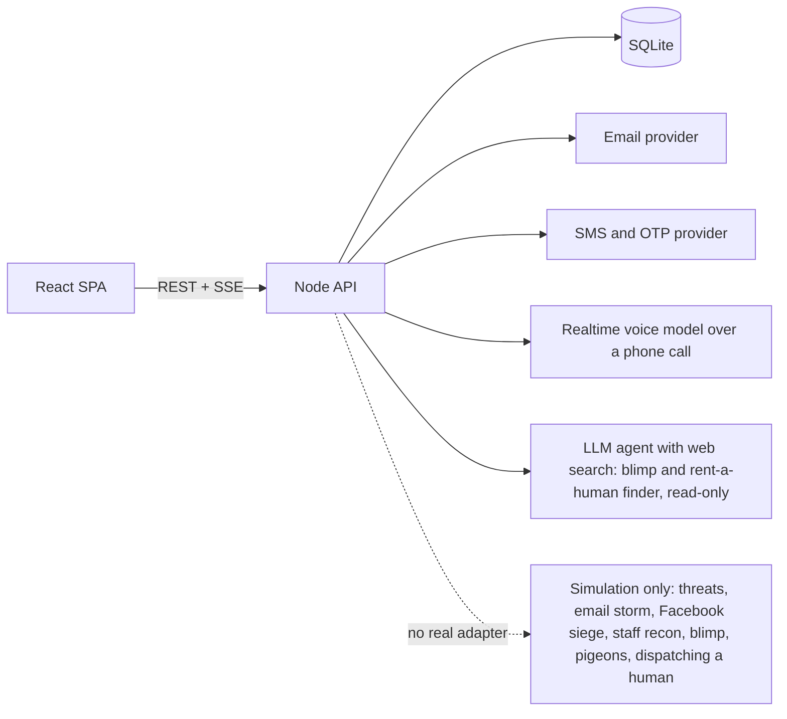

# Big bang modernization

## Orientation

## What the system is

`rengas-online-contactor` is a satirical joke app: an "AI outreach agent" that climbs an escalation ladder to get a reply from Rengas Online, a real Finnish tyre retailer. It is **browser-only**: Vite 8 + TypeScript 6, no framework, no backend, no network calls, no persistence apart from one sessionStorage flag that records the disclaimer acknowledgement. Two commits: the initial commit, then f5b9e78 (PR #1) with the whole app.

### Parts (1,071 lines total)
- `src/ladder.ts` (323 lines): the domain data and rules. There are 8 rungs with 9 actions. Each action has a channel (web, phone, email, sms, voice, social, osint, blimp), a list of pretend key specs, a list of scripted log lines and optional speech text. There are also four pure functions:
  - `validateKey` checks shape only: 8+ characters, no spaces.
  - `isUnlocked` says whether a rung is open, which needs every rung below it to have its keys.
  - `canAttemptUnlock` says whether keys can be entered for a rung. Only the next rung up qualifies.
  - `currentLevel` returns the highest open rung.
- `src/main.ts` (292 lines): the UI, written as imperative innerHTML templates. It covers the disclaimer modal (which cannot be dismissed until acknowledged), the rung cards, the key forms with a fake 900 ms "verifying" delay, a scripted activity log tagged SIMULATED (one line every 550 ms), a staff-mood meter, and a "De-escalate" reset that cancels runs in progress through a counter. The robocall rung reads its script aloud with the browser's own `speechSynthesis`, through the user's speakers only.
- `src/style.css` (381 lines): a single theme. The background gets angrier per level through `body[data-level]`.
- `src/ladder.test.ts` (75 lines): Vitest unit tests for ladder order, unlocking rules, unique IDs and key validation. There are no UI tests.
- Tooling: ESLint 10 with typescript-eslint, Prettier, strict tsconfig, Node 22.12+ and pnpm. Scripts are dev (127.0.0.1:5173), build, typecheck, lint, format:check and test. `dist/` and `node_modules/` exist locally but are gitignored.

### The ladder that the rewrite must cover
| Level | Rung | Pretend keys | Actions |
|---|---|---|---|
| 1 | Polite customer inquiry | none | contact form, call customer service |
| 2 | Firmly worded email | email provider key | firm email |
| 3 | Robo-emails | bulk mailing key | 900-email storm |
| 4 | Ominous text messages | SMS account ID + token | menacing SMS |
| 5 | AI robocalls | voice key + neural speech key | robocall loop, plus "hear it" playback in the browser |
| 6 | Social media siege | Facebook Graph token | Messenger, comments, sonnet review |
| 7 | Staff recon | scraping key | invented staff ("Reijo Rengasmäki") |
| 8 | Total escalation | blimp key + pigeon licence | blimp, pigeons, mariachi, happy ending |

### What it talks to
Nothing. Keys are checked for shape, then thrown away. Recipient addresses are `.example.invalid`. Every action prints canned lines.

## Where the documentation was wrong or missing
- **The project material Factory keeps is empty.** The index, map, knowledge and tests folders contain only artifact metadata. There is no overview.md, parts.md or system map, so I oriented from the README and the source.
- **The README is accurate about the code.** Its ladder table, the "nothing is ever sent" claim, the key-shape rule, the speaker-only speech and the commands all match the source.
- **What is missing is the user's intent.** The README and the in-app copy describe a deliberately fake app: "the integrations are fake on purpose". The user says that misread the request. With API keys given, the app should really do what the ladder describes. The new README, disclaimers and UI copy must describe real sending to verified recipients, keep the abusive rungs labelled simulation, and drop the claim that nothing ever sends.
- There is no documentation of architecture, testing or design. That fits the size of the current app, and the rewrite has to supply it.

## Implications for the rewrite
- The parity baseline is small and clear: the 8 rungs, the next-rung-only unlock rule, key forms, the scripted log, the mood meter that escalates, de-escalate and reset, the disclaimer gate and in-browser speech. Parity testing can be driven from the `RUNGS` data and the four rule functions.
- The real work is everything the old app never had: React, a backend that keeps provider secrets on the server, real email, SMS and AI voice when keys are given, recipient verification by one-time code, confirmation before each real send and rate limits, and an agent that finds real blimp or rent-a-human options without booking or contacting anyone. Product concept, architecture and UI all need design before building.
- The old code holds nothing worth carrying over except the ladder copy and the jokes, which the product design can reuse.

## Users, flows and needs

## Who uses it

| Who | Kind | What they need |
|---|---|---|
| **The operator and presenter** (the user, JP) | person, at the keyboard | Climb the ladder in a demo, unlock rungs, run the actions and get laughs. In the rewrite: enter real provider keys and have email, SMS and voice really go out to *their own* verified phone and inbox. They also need something polished enough to show people. |
| **The audience** watching the demo | people, looking at the screen | Read the escalation at a glance: the mood meter, the page getting angrier, the log streaming lines, the robocall voice. They must be able to tell real from simulated, because the SIMULATED tag and the disclaimers are part of the joke and part of the safety. |
| **Rengas Online and its staff** | not users, the target | Never receive anything. Today that holds because nothing sends. In the rewrite it holds because real sends only reach recipients the operator verified as their own, and the abusive rungs never send at all. |
| **Providers** (email, SMS, voice, AI search) | machines, new in the rewrite | Valid credentials, kept on the server, with calls that are rate-limited and confirmed. The current app has none. |
| **Developers and CI** | people and machines | Run the checks: typecheck, lint, format:check, test and build. The rewrite keeps an equivalent set and adds backend tests. |

## Flows the current code supports

1. **Disclaimer gate.** On first load, a modal asks the operator to tick "I understand this is a joke" before entering. Undocumented details:
   - Escape is blocked.
   - If Chromium force-closes the modal, it reopens until acknowledged.
   - The acknowledgement lives in **sessionStorage**, so it lasts for the tab: a reload skips the modal, a new tab shows it again.
2. **Start state.** Level 1 (Polite) is open with no keys. The log greets "Agent ready. Target: Rengas Online…".
3. **Unlock the next rung.**
   - Only the next rung up shows a key form. Higher rungs show "Unlock the level below first. Needs: …".
   - Each key is checked for shape, with an error under each field: "Enter a key.", "Keys don't have spaces in them." or "at least 8 characters".
   - When the keys pass, there is a fake 900 ms "Verifying keys…" wait with the inputs disabled. Then the rung opens and the log line says the keys were accepted by shape and thrown away.
   - The page scrolls to the newly opened rung.
4. **Run an action.**
   - The button changes to "Running…" and is disabled, so the same action cannot run twice at once.
   - The script lines stream into the log every 550 ms, tagged SIMULATED, and the run ends with "✔ Done. Nothing was actually sent."
   - Different actions can run at the same time.
   - Undocumented: while an action runs, only its button updates. A full redraw would wipe keys the operator is still typing into another rung's form.
5. **Hear the robocall.** Level 5 reads its speech text through the browser's `speechSynthesis` at rate 0.9 and pitch 0.7. Pressing it again cancels the previous playback. Without speech support, the log says "imagine a very tired robot voice".
6. **Escalation feedback.** The mood meter shows the current rung's threat label ("Calm" up to "Fleeing Country"), and its fill grows with the level. The page background darkens per level through `body[data-level]`. The rungs are listed top-down from level 8 to level 1, so the ladder visually climbs.
7. **De-escalate.** Forgets every unlock and cancels every running script and every pending verification through a counter, so lines from those runs never show up after the reset. It also stops speech, logs a "maybe send one nice email" line and redraws at level 1. The log is **not** cleared.
8. **Reload.** Unlocks and the log are lost, because they are held in memory only. The disclaimer acknowledgement survives. No keys are ever stored.

## Edge cases and data people rely on

- **The ladder data in `RUNGS`.** The 8 rungs keep their order and wording. Each has a title, tagline, threat label, key labels with provider-looking placeholders (SG., AC…, EAAG…), scripted lines and the robocall speech. These carry the comedy, and the rewrite keeps or improves them.
- **Rules pinned by tests:**
  - Unlocking goes in order, one rung at a time, with no skipping.
  - Level 1 needs no keys and every other level needs at least one.
  - Robo-emails and robocalls come before the social rungs.
  - IDs are unique.
- **Accessibility details:**
  - The log uses `aria-live="polite"` and shows the newest line first.
  - Key inputs are password fields with autocomplete and spellcheck off, and invalid ones get `aria-invalid`.
  - The banner uses `role="alert"`.
  - The meter and the ladder have ARIA labels.
- **Disclaimers in three places:** the banner, the modal and the footer. The rewrite keeps them visible but changes what they say.
- **Fictional staff.** Staff recon names a made-up person and labels the results invented. That stays.

## What changes for these users in the rewrite (from the request and the safety boundary)

- **Keys stop being pretend.**
  - Keys go to the backend, which validates them against the provider and keeps them on the server, never in browser storage.
  - Without keys, everything simulates as it does today.
- **New flows the operator needs:**
  - Verify their own recipients with a one-time code, an email address and a phone number.
  - Confirm each real send explicitly.
  - See the rate limits and what remains.
  - See which channels are real and which are simulated in the log, per run.
  - Place a real AI voice call to their own verified phone using a current realtime speech model.
  - Run the "find an equivalent" agent, which searches for real blimp or rent-a-human options and shows them, but books nothing and contacts no one.
- **Rungs that stay simulation forever:** threats, the robo-email storm, the Facebook siege, staff recon, the blimp, carrier pigeons and dispatching a rented human. They stay clearly labelled and never send.
- **The current state model** (in-memory unlocks, reset cancels everything in progress) becomes server-side state per operator session. De-escalate still has to cancel anything queued or in flight, including real sends that are waiting for confirmation.

## A modern rewrite

## The picture

A modern rebuild is a small, polished **full-stack TypeScript app**, run as one pnpm workspace. A React single-page app talks to a Node backend. The backend owns everything that matters:
- provider keys, kept on the server and never sent back to the browser
- the ladder rules and the unlock state per operator session
- the recipients the operator has verified with a one-time code
- confirmation and rate limits for every real send
- run records, streamed to the browser as a live log over server-sent events (SSE)
- the provider adapters

Every channel has two adapters behind one interface, a real one and a simulated one. The backend picks the real one only when the keys are present and valid, the channel is one that may send for real, and the recipient is verified. The abusive rungs have **no real adapter at all**, so the safety boundary is enforced by what the code contains, not by a flag. With no keys, the whole app works as a simulation, as it does today.

## Stack, part by part

| Part | Today | Rewrite | Why |
|---|---|---|---|
| Language | TypeScript 6, strict | **Keep** TypeScript, strict, on both client and server | One language end to end. The resume advice suggested it, and the shared ladder and API types justify it. |
| Runtime | Node 22.12+ (dev only) | **Node 24 LTS** | Current LTS. It has built-in `node:sqlite`, native fetch and native test-friendly ESM. |
| Package manager | pnpm | **Keep** pnpm, using workspaces (`apps/web`, `apps/server`, `packages/shared`) | Sound and already used. Workspaces give a clean split between client, server and shared contracts. |
| Front-end framework | none (innerHTML templates) | **React 19.2** | The user requires it. 19.2.x is the current stable line. |
| Build and dev server | Vite 8 | **Keep** Vite 8 with `@vitejs/plugin-react` | Still the standard React SPA tool. It proxies `/api` to the backend in dev. |
| Routing and server state | none | **TanStack Router + TanStack Query** | Type-safe routes for the ladder, recipients, settings and run views. Query handles caching and mutations for the API. Both are actively released in 2026. |
| Styling and components | one hand-written CSS file | **Tailwind CSS v4** with accessible headless primitives (Radix or React Aria), plus Motion for the escalation animation | Demo polish, accessible dialogs for the disclaimer and the send confirmations, and less hand-rolled CSS. The UI design picks the exact look. |
| Backend framework | none | **Hono 4** on `@hono/node-server` (Fastify 5 is the alternative) | Hono is small, Web-standard, has first-class SSE streaming and typed RPC clients, and works with Zod validators. Fastify is equally fast on Node 24. Technical design settles the choice. |
| Validation and contracts | hand-written `validateKey` | **Zod**, with the schemas in `packages/shared` | One schema checks input at the API boundary and types the client. |
| Persistence | none (memory + sessionStorage) | **SQLite through `node:sqlite` + Drizzle ORM** and drizzle-kit migrations | A single file, zero infrastructure, fine for internal testing. It stores sessions, verified recipients, rate-limit counters and run history. Keys are encrypted at rest, or held only in server memory. |
| Email (real) | fake | a transactional email API, Resend as the default candidate | Simple REST/SDK and a verified sender domain. Only neutral content goes to verified recipients. |
| SMS and OTP (real) | fake | **Twilio** (Messaging + Verify) | Verify sends and checks the one-time codes that prove a recipient belongs to the operator. The same account sends the neutral SMS. |
| AI voice call (real) | browser `speechSynthesis` | **OpenAI Realtime API (gpt-realtime) over SIP through a Twilio number**, or a WebSocket media-stream bridge | It places a live, conversational AI call to the operator's own verified phone. Sources disagree on how mature native SIP is, and community threads report SIP drops, so technical design must pick SIP or a bridge after a probe. Browser speech stays as the preview when no keys are set. |
| "Find an equivalent" agent | n/a | An LLM with a web-search tool (OpenAI Responses web search or similar), read-only | It searches for real blimp or airship advertising and for rent-a-human options such as RentAHuman.ai, which has MCP and REST access and launched in 2026. It shows results with links. It **never books or contacts anyone**, so no booking or messaging tool is wired in. |
| Live log | DOM prepend | **Server-sent events** from the run engine | One-way streaming is all the log needs, and SSE is simpler than WebSockets. |
| Tests | Vitest 5 (unit) | **Keep** Vitest 5 for unit and integration tests (server routes with mocked providers, React Testing Library) and **add Playwright** end-to-end tests for the ladder journeys | Vitest is still current. Playwright covers the browser flows, including mobile sizes. |
| Lint and format | ESLint 10 + typescript-eslint, Prettier 3 | **Keep** them, and add the React Hooks and jsx-a11y rules | All three are still sound. The user asked for very clean code. |
| Secrets and config | none | `.env` loaded and checked by Zod at startup, `.env.example` committed | Provider secrets stay on the server, and a missing key means that channel simulates. |
| Run and deploy | `vite dev` | `pnpm dev` runs web and server together. A production build serves the SPA from the Node server, with an optional Dockerfile. | Internal testing needs one command and a single process to demo. |

## What carries over and what goes

- **Kept as content:** the ladder's 8 rungs, the titles, taglines, threat labels and scripts, the next-rung-only unlock rule, the mood meter and the escalating theme, de-escalate and reset, the disclaimer gate and the fictional staff. All of this moves into `packages/shared` as data.
- **Replaced:** the innerHTML UI, shape-only key checks (now real validation against each provider), in-memory state, the "nothing is ever sent" copy, and the single CSS file.
- **Thrown away** once parity holds: `src/main.ts`, `src/ladder.ts`, `src/style.css`, the root `index.html` and the single-package setup.

## Open questions for the next stages
- Hono or Fastify.
- Native OpenAI SIP or a media-stream bridge for the voice call.
- Which email provider.
- Whether keys are entered in the UI and held encrypted on the server, or set in `.env`. The ladder's "enter keys to unlock" joke favours the UI, so keys entered there go to the server and are held encrypted.
- What "much more ambition" means as a product. Product design should settle this before the UI is built.

Version notes come from 2026 web sources, mostly aggregators: React 19.2.x, Hono 4.13, Fastify 5.12, Drizzle with native `node:sqlite` support, gpt-realtime with SIP. Workers should confirm the exact versions on npm when they install.

Sources: [OpenAI Realtime SIP guide](https://developers.openai.com/api/docs/guides/realtime-sip), [Twilio + OpenAI SIP tutorial](https://www.twilio.com/en-us/blog/developers/tutorials/product/openai-realtime-api-elastic-sip-trunking), [Fora on SIP maturity](https://www.forasoft.com/blog/article/openai-realtime-api-webrtc-sip-websockets-integration), [React versions](https://versionlog.com/react/), [Hono vs Fastify 2026](https://betterstack.com/community/guides/scaling-nodejs/hono-vs-fastify/), [Drizzle node:sqlite](https://orm.drizzle.team/docs/connect-node-sqlite), [Twilio Verify skill](https://www.skills.sh/twilio/ai/twilio-verify-send-otp), [RentAHuman](https://www.everydev.ai/tools/rent-a-human).

## Architecture and technical choices

## Architecture

The rewrite is a pnpm TypeScript monorepo with three parts:
- **apps/web**: a React 19 single-page app.
- **apps/server**: a Hono API on Node 24, with SQLite through Drizzle.
- **packages/shared**: the ladder content and the Zod API contracts, used by both apps.

The full write-up with a diagram, the data tables and an API sketch is saved in project knowledge at `architecture/index.md`.

### Parts and boundaries
- **Run engine and channel adapters.** Every action runs through a channel adapter (register `channel-adapters`). Real adapters exist only for neutral email, SMS, the voice call and the read-only finder search. A real adapter runs only when the key is validated, the recipient is verified and the send is confirmed. Actions on the abusive rungs are typed simulation-only in `packages/shared`, so no real adapter can be attached to them. This is how the code enforces the boundary in register `safety-boundary`.
- **Send guard** (`send-guard`):
  - One-time codes verify recipients: Resend for email and Twilio Verify for SMS. Email codes are stored hashed, expire after 10 minutes and allow 5 attempts.
  - A real send starts as a preview. The send needs a confirmation token that is single-use and lasts 5 minutes.
  - At send time the server checks verification and per-channel rate limits again. The limits are configurable, with defaults of 3 emails, 3 SMS and 2 calls an hour, and 10 sends a day.
  - Every real send is recorded.
- **Key vault** (`provider-keys`):
  - The operator still enters keys in the rung forms.
  - The server checks each key live against its provider, then stores it encrypted with AES-256-GCM under `APP_SECRET`.
  - The browser only ever sees a masked hint.
  - Keys can also be preset in `.env`.
  - De-escalate deletes the stored keys.
- **Runs and the live log** (`runs-and-sse`): runs and their events are stored in SQLite and streamed to the browser over SSE, which replays missed events after a reconnect. The old rules carry over: the same action can't run twice at once, and De-escalate cancels everything in progress.
- **Providers** (`providers`):
  - Resend sends email.
  - Twilio covers SMS, the one-time codes and the phone line.
  - OpenAI covers gpt-realtime for the call and Responses with web_search for the finder and the neutral message text.
  - Each provider sits behind a client module that tests can fake.
- **Voice call** (`voice-call-approach`): Twilio dials the operator's verified phone. A server bridge connects the call's audio to gpt-realtime. The call has a neutral persona and a 90-second cap, and its transcript streams into the log. The implementer may switch to OpenAI's native SIP connection only if a probe shows it is reliable.
- **Finder agent** (`finder-agent`):
  - It searches the web for real blimp, banner-plane and rent-a-human options, such as RentAHuman.ai, and shows them as cards with source links.
  - "Simulate booking" only plays a scripted run.
  - It has no booking or contact tools, and the server never fetches the sites it finds.
  - With no OpenAI key it shows canned examples, labelled as such.
- **Sessions and hosting** (`session-and-hosting`):
  - There are no accounts. Each operator gets an httpOnly, SameSite=Strict session cookie.
  - The server binds to 127.0.0.1 and checks that state-changing requests come from the same origin.
  - The config is checked with Zod at startup, and a missing key means that channel simulates.
  - `pnpm dev` runs the web app and the server together. `pnpm build && pnpm start` runs one Node process.
  - `PUBLIC_BASE_URL` points Twilio callbacks at the operator's tunnel.

### Data
There are nine SQLite tables: sessions, provider_keys, unlocks, recipients, verification_codes, send_confirmations, runs, run_events and sends. They are managed by drizzle-kit migrations. The old app stores no data, so only the ladder content moves into `packages/shared` (register fact `no-data-to-migrate`).

### Stack
Full list in register `stack-and-layout`:
- **Web:** React 19.2, Vite 8, TanStack Router and Query, Tailwind v4, Radix, Motion.
- **Server:** Hono 4, Zod, Drizzle on node:sqlite.
- **Checks:** Vitest 5, Playwright, ESLint 10 with typescript-eslint, react-hooks and jsx-a11y, Prettier 3, strict TypeScript.

### Still open
- **What "much more ambition" means as a product** (unknown `ambition-shape`). A product design job will settle it before the UI design and the front-end work start, and it may add rungs, channels or an agent planning step on top of this architecture.

## Parity testing plan

## Parity plan

The full plan is in `parity-plan.md` in the task folder.

**Evidence from the old system that stays usable after deletion**
- The old app stays runnable from commit `f5b9e78` (`git worktree add ../old f5b9e78 && pnpm install && pnpm dev`). That commit stays on `main` after the old code is deleted.
- The first implementation job records these under `tests/parity/fixtures/`, before anything is deleted:
  - `ladder.json`: all rung, key and action content, including the script lines and the robocall speech.
  - `rules.json`: the outputs of `isUnlocked`, `canAttemptUnlock`, `currentLevel` and `validateKey` over every unlock subset and a set of key strings.
  - Screenshots of the old app's states at 1280 px and 390 px.

**Behaviours compared**

| # | Behaviour | How it is compared |
|---|---|---|
| 1 | Rungs, order, keys and actions | Data check against `ladder.json`, with an explicit table for any renames |
| 2 | Next-rung-only unlock rules | `rules.json` replayed through the new shared rules and the unlock API |
| 3 | Key form error messages | `rules.json` replay plus an API contract test |
| 4 | Unlock journey | Playwright |
| 5 | Simulated runs | Streaming, the SIMULATED tag, no duplicate runs, parallel runs, typed keys not wiped; checked with the API, SSE order and Playwright |
| 6 | Mood meter and escalating theme | Playwright |
| 7 | De-escalate | Cancels in-flight work with no late events, stops speech, keeps the log; API test plus Playwright |
| 8 | Disclaimer gate | Can't be dismissed, blocks Escape, reopens, lasts for the tab; Playwright |
| 9 | Browser speech preview and its fallback | Playwright with stubbed speech |
| 10 | Disclaimers and the invented-staff label | Playwright text checks plus a content review |
| 11 | Accessibility attributes | Playwright with axe |
| 12 | Full climb with no keys | Simulation only, zero provider calls; desktop and mobile journey with fake provider clients that fail the test if called |

**Differences the new system is meant to have** (not parity failures)
- Real email, SMS and AI calls when keys are given, only to verified recipients, after preview and confirmation, within rate limits.
- Keys checked live and stored encrypted on the server.
- New flows: recipients, verification codes, previews, visible rate limits, the real robocall and the finder agent.
- Session state and the log survive a reload.
- React and the new visual design, plus the rungs and actions the product design adds. Those have their own tests.
- Wording may improve. Parity holds on meaning and order, but the safety labels and disclaimers must stay.

**Safety checks beyond parity**
- With all keys set and a verified recipient, every simulation-only action makes zero provider calls.
- The server refuses a real send that has no valid token, targets an unverified recipient, is over the limit, or comes after De-escalate.
- The finder agent's only tool is web search.

**When it is done:** rows 1–12 and the safety checks pass, and the fixtures are committed. Then the old `src/`, the root `index.html` and the single-package config are deleted.

## PR-sized steps

## Steps and their dependencies

The old app stays in place and keeps building until the removal stage. The new workspace grows alongside it.

| ID | Step | Kind and specialist | Depends on |
|---|---|---|---|
| D1 | **Product concept: what "much more ambition" means.** Settles unknown `ambition-shape`. Covers the agent persona, how messages are written with an LLM, any new rungs or features, the final ladder content and jokes, the neutral real-message copy, and the disclaimers and safety labels. Must stay inside `safety-boundary`. | design, product_design, sota, deep | none |
| D2 | **Visual and interaction design.** Renders desktop and mobile views of the ladder, key forms, live log, escalation visuals, recipients and verification, send preview and confirmation, real versus simulated marking, the call view and the finder cards. | design, ui_design, sota | D1 |
| S0 | **Record the old system's evidence.** Writes `tests/parity/fixtures/ladder.json`, `rules.json` and the old app's screenshots from `f5b9e78`. | implementation, test_engineer, light | none |
| S1 | **Workspace scaffold.** Sets up the pnpm workspace (`apps/web`, `apps/server`, `packages/shared`), strict TypeScript, ESLint with react-hooks and jsx-a11y, Prettier, Vitest, Playwright, root scripts (`dev`, `build`, `start`, `typecheck`, `lint`, `test`, `e2e`), and the `.env.example` and config skeleton. The old app keeps building. | implementation, infrastructure_engineer, medium | none |
| S2 | **Shared ladder and contracts.** Moves the ladder content, with each action marked `real-capable` or `simulation-only`, into `packages/shared`. Adds the unlock rules, the Zod API and run-event schemas, and parity rows 1–3 against the fixtures. | implementation, backend_engineer, strong | S0, S1, D1 |
| S3 | **Server core.** Covers the config check at startup, the session cookie with the same-origin check, the Drizzle schema and migrations, the state, unlock and reset endpoints, the run engine with simulated adapters, and the SSE stream with replay. Carries the API parity tests for rows 2, 3, 5 and 7, plus zero provider calls with no keys. | implementation, backend_engineer, strong | S2 |
| S4 | **Key vault and live key checks.** Encrypts keys with AES-256-GCM, returns only masked hints, accepts keys preset in `.env`, checks each key live against Resend, Twilio and OpenAI behind client modules that tests can fake, and deletes keys on reset. | implementation, backend_engineer, strong | S3 |
| S5 | **Recipients and send guard.** Adds email and phone one-time codes, send previews with single-use confirmation tokens, rate limits, the send records, cancellation on De-escalate, and the safety refusal tests. | implementation, backend_engineer, strong | S3 |
| S6 | **Real email and SMS adapters.** Sends through Resend and Twilio Messaging, with OpenAI writing the neutral message text. | implementation, backend_engineer, medium | S4, S5 |
| S7 | **Real AI robocall.** Builds the Twilio outbound call, the media-stream bridge to gpt-realtime, the 90-second cap and hangup, and the transcript in the run events (`voice-call-approach`). | implementation, backend_engineer, sota | S4, S5 |
| S8 | **Finder agent.** Uses OpenAI Responses with web_search as its only tool and returns structured results. Shows canned example results without a key. Includes the safety test that its tool list holds only web search. | implementation, backend_engineer, strong | S4 |
| W1 | **Web foundation.** Builds the React shell, routing, typed API client, SSE log, disclaimer gate, ladder, key forms, mood meter and theme, De-escalate and the speech preview, following D2. Carries the Playwright parity rows 4–12 at desktop and mobile sizes. | implementation, ui_engineer, strong | S3, D2 |
| W2 | **Web real-send flow.** Builds recipient management and verification, send preview and confirmation, real versus simulated marking, rate limits shown in the UI, and the key status. | implementation, ui_engineer, strong | W1, S5 |
| W3 | **Web call, finder and the ambition features from D1.** Builds the live call view with its transcript, the finder result cards with "Simulate booking", and the D1 extras. | implementation, ui_engineer, strong | W1, S7, S8 |
| Q1 | **Whole-app checks and docs.** Covers the full climb end to end with and without keys (fake providers), the safety checks, a new README with setup and provider guide, the tunnel note, and how to verify recipients. | implementation, test_engineer + documentation_writer, medium | W2, W3, S6 |

**What runs side by side**
- D1, S0 and S1 start straight away.
- S4 and S5 run in parallel after S3.
- S6, S7 and S8 run in parallel.
- W1 starts once the server core and the visual design are done.
- W2 and W3 run in parallel.

Removing the old code is left to the later removal stage, after the parity run.

D1 may add rungs or features. When it returns, I will revise the scope of S2 and W3, and add server steps if its features need them.

## Orientation

## Orientation (unchanged since the first pass; the checkout is still at f5b9e78 with no changes)

**What the system is.** `rengas-online-contactor` is a satirical joke app: an "AI outreach agent" that climbs an 8-rung escalation ladder to get a reply from Rengas Online, a real Finnish tyre retailer. It runs only in the browser: Vite 8 + TypeScript 6, no framework, no backend, no network calls. Its only stored state is a sessionStorage flag recording that the disclaimer was acknowledged.

**Parts (1,071 lines total)**
- `src/ladder.ts` holds the `RUNGS` data: 8 rungs and 9 actions, with titles, taglines, threat labels, pretend key specs, scripted log lines and the robocall speech. It also holds the rules `validateKey` (8+ characters, no spaces), `isUnlocked`, `canAttemptUnlock` (next rung only) and `currentLevel`.
- `src/main.ts` builds the UI from innerHTML templates:
  - a disclaimer modal that can't be dismissed until acknowledged
  - key forms with a fake 900 ms verification
  - a log tagged SIMULATED that streams one line every 550 ms
  - a mood meter
  - De-escalate, which cancels work in progress
  - a browser `speechSynthesis` robocall preview
- `src/style.css` holds a theme that grows angrier with each level.
- `src/ladder.test.ts` has Vitest tests for the rules.
- Tooling: ESLint 10, Prettier, strict tsconfig, Node 22.12+ and pnpm.

**What it talks to.** Nothing. Keys are checked for shape, then thrown away. Recipient addresses end in `.example.invalid`.

**Where the documentation was wrong or missing**
- The project material Factory keeps for the repository had no index or map. Project knowledge now has `architecture/index.md`, written in an earlier pass of this run.
- The README matches the code. It describes a deliberately fake app, which the user says was a misreading. The rewrite has to replace the "nothing is ever sent" copy.
- There is no architecture or testing documentation.

**Carried forward from earlier stages, still valid**
- Register decisions: safety-boundary, stack-and-layout, channel-adapters, provider-keys, providers, send-guard, runs-and-sse, session-and-hosting, voice-call-approach and finder-agent.
- Fact no-data-to-migrate, and the open unknown ambition-shape.
- `parity-plan.md` in the task folder.

**Why this stage is running again.** The last execute_plan was rejected because two job IDs (`send-guard`, `finder-agent`) were the same as register entry IDs. When I submit the plan again, I will rename those jobs, for example to `send-guard-server` and `finder-agent-server`.

## Users, flows and needs

## Users

| Who | Kind | What they need |
|---|---|---|
| **Operator and presenter** (the user) | person | Climb the ladder in a demo and get laughs. In the rewrite, they enter real keys and have neutral email, SMS and an AI call really reach *their own* verified inbox and phone. The result must be polished enough to show. |
| **Audience** | people watching | Follow the escalation at a glance: meter, angrier theme, streaming log, voice. They must always be able to tell what is real and what is SIMULATED. |
| **Rengas Online and its staff** | target, not a user | Never receive anything. |
| **Providers** (email, SMS, voice, AI search) | machines, new in the rewrite | Valid keys held on the server, with calls that are rate-limited and confirmed. |
| **Developers and CI** | people and machines | The checks: typecheck, lint, format:check, test and build. |

## Flows the code supports, including undocumented ones

1. **Disclaimer gate.** Entry requires ticking the box. Escape is blocked, and the modal reopens if Chromium force-closes it. The acknowledgement is stored in sessionStorage, so a reload skips the gate but a new tab shows it again.
2. **Start.** Level 1 is open without keys, and the log greets the operator.
3. **Unlock.**
   - Only the next rung up shows a key form. Higher rungs show "Unlock the level below first. Needs: …".
   - Each field shows its own error: "Enter a key.", "Keys don't have spaces in them." or "at least 8 characters", and the field gets `aria-invalid`.
   - A valid submit shows a 900 ms "Verifying keys…" state with the inputs disabled.
   - Then the rung opens, the log records it and the page scrolls to the rung.
4. **Run an action.**
   - The button shows "Running…" and is disabled, so the same action can't run twice at once.
   - The lines stream every 550 ms, tagged SIMULATED, and end with "Nothing was actually sent."
   - Different actions can run in parallel.
   - Undocumented: only the button itself redraws, so keys being typed in another form are not wiped.
5. **Robocall preview.** Plays through the operator's own speakers with `speechSynthesis` (rate 0.9, pitch 0.7). A repeat press restarts it. Without speech support, the log shows a fallback line.
6. **Escalation feedback.** The threat label and meter fill follow the current level, and `body[data-level]` makes the theme angrier. Rungs are listed from level 8 at the top down to level 1.
7. **De-escalate.** Clears unlocks and cancels running scripts and pending verifications without late lines. It also stops speech and logs a line. The log is kept.
8. **Reload.** Loses unlocks and the log, keeps the disclaimer acknowledgement, and never keeps keys.

## Edge cases and data people rely on

- **The `RUNGS` content.** The order, titles, taglines, threat labels, provider-looking placeholders, scripts and speech are the comedy.
- **Rules pinned by tests.** Unlocking is next-rung-only, level 1 needs no keys and every other level needs keys, robo-emails and robocalls come before the social rungs, and IDs are unique.
- **Accessibility.**
  - The log is a polite live region with the newest line first.
  - Key fields are password inputs with autocomplete and spellcheck off.
  - The banner uses `role="alert"`.
  - The meter and the ladder have labels.
- **Disclaimers.** They appear in the banner, the modal and the footer. Staff recon results are invented and labelled that way.

## New needs the rewrite adds (from the request and register decision safety-boundary)

- **Real keys.** Keys are validated live and kept on the server. Without keys, everything simulates.
- **Recipient verification.** One-time codes prove the email address and phone number belong to the operator.
- **Real sends.** Each real send is previewed and explicitly confirmed, and rate limits are visible.
- **Real and simulated runs.** Every run is marked real or simulated in the UI and the log.
- **Real AI call.** It goes to the operator's verified phone.
- **Finder agent.** It shows real blimp and rent-a-human options, but books and contacts nothing.
- **Rungs that never send.** The abusive rungs stay simulated: threats, the email storm, the Facebook siege, staff recon, the blimp, pigeons and dispatching a human.
- **State.** Unlocks, keys, recipients and the log live on the server per session. De-escalate also cancels pending confirmations and real work in flight.

## A modern rewrite

## The picture (unchanged from the earlier pass of this stage)

The rewrite is a full-stack TypeScript app in one pnpm workspace:
- A React single-page app talks to a Node backend.
- The backend holds the provider keys, the ladder state for each session, the verified recipients, the confirmation and rate limits for real sends, and the run records.
- Run records stream to the activity log over server-sent events.
- Each channel has a real adapter and a simulated adapter. Only neutral email, SMS, the voice call and the read-only finder search have real adapters.
- The abusive rungs have no real adapter at all.
- With no keys, everything simulates.

## Stack, part by part

| Part | Today | Rewrite | Why |
|---|---|---|---|
| Language | strict TypeScript 6 | **Keep**, on both client and server | One language, with shared ladder data and contracts |
| Runtime | Node 22.12+ | **Node 24 LTS** | Current LTS, with built-in `node:sqlite` |
| Package manager | pnpm | **Keep**, with workspaces (web, server, shared) | Sound, and already in use |
| UI | none | **React 19.2** | The user requires it; 19.2.x is the current stable line |
| Build | Vite 8 | **Keep**, with plugin-react | Still the standard tool for a React single-page app |
| Routing and data | none | **TanStack Router + Query** | Type-safe routes, cached API calls; actively released in 2026 |
| Styling | one CSS file | **Tailwind v4 + Radix primitives + Motion** | Demo polish and accessible dialogs |
| Backend | none | **Hono 4** on @hono/node-server (Fastify 5 is the alternative) | Small, first-class SSE, typed clients; about as fast as Fastify on Node 24 |
| Contracts | hand-written checks | **Zod** schemas, shared | One check at the API boundary that also types the client |
| Storage | memory | **SQLite through `node:sqlite` + Drizzle** | No infrastructure needed for internal testing; Drizzle supports `node:sqlite` natively |
| Email | fake | **Resend** | Simple REST API |
| SMS and codes | fake | **Twilio** Messaging + Verify | One account covers SMS, the one-time codes and the phone line |
| AI call | browser speech | **OpenAI gpt-realtime**, connected to a Twilio call through a media-stream bridge (native SIP as the alternative) | Sources disagree on how mature SIP is |
| Finder agent | none | **OpenAI Responses with web_search only** | Finds real blimp and rent-a-human options (e.g. RentAHuman.ai, which has MCP and REST access) and books nothing |
| Live log | DOM | **SSE** | One-way streaming is all the log needs |
| Tests | Vitest 5 | **Keep**, and **add Playwright** | Server, component and browser journeys |
| Lint and format | ESLint 10, Prettier 3 | **Keep**, and add react-hooks and jsx-a11y | The user asked for very clean code |
| Config | none | `.env` checked with Zod at startup, plus `.env.example` | Provider secrets stay on the server |
| Run | `vite dev` | `pnpm dev`, and in production one Node process | Simple to demo |

## What carries over

- **Kept as data:** the ladder content and its rules.
- **Replaced:** the innerHTML UI, the shape-only keys, the in-memory state, the "nothing is ever sent" copy and the CSS file.
- **What "much more ambition" means** is left to product design (unknown ambition-shape).

Sources: [OpenAI Realtime SIP](https://developers.openai.com/api/docs/guides/realtime-sip), [Twilio + OpenAI SIP](https://www.twilio.com/en-us/blog/developers/tutorials/product/openai-realtime-api-elastic-sip-trunking), [SIP maturity](https://www.forasoft.com/blog/article/openai-realtime-api-webrtc-sip-websockets-integration), [React versions](https://versionlog.com/react/), [Hono vs Fastify](https://betterstack.com/community/guides/scaling-nodejs/hono-vs-fastify/), [Drizzle node:sqlite](https://orm.drizzle.team/docs/connect-node-sqlite), [RentAHuman](https://www.everydev.ai/tools/rent-a-human).

## Architecture and technical choices

## Architecture (unchanged; recorded in the register and in project knowledge `architecture/index.md`)

A pnpm TypeScript monorepo in three parts:
- **apps/web**: a React 19 single-page app.
- **apps/server**: a Hono 4 API on Node 24, with SQLite stored through Drizzle on `node:sqlite`.
- **packages/shared**: the ladder content and the Zod contracts that both apps use.

### Choices (register decisions)
- **safety-boundary**
  - Real email, SMS and AI calls go only to recipients the operator has verified with a one-time code.
  - Each real send is confirmed by the operator, rate-limited and uses neutral content.
  - The abusive rungs always simulate and never send.
  - The finder agent searches and shows results, but books nothing and contacts no one.
  - With no keys, everything simulates.
- **stack-and-layout**: React 19.2, Vite 8, TanStack Router and Query, Tailwind v4, Radix and Motion on the web side. Hono, Zod and Drizzle on the server. Vitest, Playwright, ESLint with react-hooks and jsx-a11y, Prettier and strict TypeScript for checks.
- **channel-adapters**: each action runs through a channel adapter.
  - Only email, SMS, voice and the finder have real adapters.
  - A real adapter is used only when the key is validated, the recipient is verified and the send is confirmed.
  - Abusive actions are typed simulation-only.
  - Every run reports whether it was real or simulated.
- **provider-keys**:
  - Keys are entered in the rung forms and checked live against the provider.
  - They are stored encrypted with AES-256-GCM under `APP_SECRET`.
  - The browser only ever sees a masked hint.
  - Keys can also be preset in `.env`, and De-escalate deletes them.
- **providers**: Resend for email, Twilio for SMS, Verify codes and calls, and OpenAI for gpt-realtime, the neutral message text and web search.
- **send-guard**:
  - Codes are hashed and expire after 10 minutes, with 5 attempts allowed.
  - A real send starts as a preview and needs a single-use confirmation token that lasts 5 minutes.
  - At send time the server checks verification and the rate limits again. The defaults are 3 emails, 3 SMS and 2 calls an hour, and 10 sends a day.
  - Every real send is recorded.
  - De-escalate cancels anything pending.
- **runs-and-sse**: runs and their events are stored in SQLite and streamed to the log over SSE, with replay after a reconnect. The same action can't run twice at once.
- **session-and-hosting**:
  - There are no accounts. Each operator gets an httpOnly, SameSite=Strict session cookie.
  - The server binds to 127.0.0.1 and checks that state-changing requests come from the same origin.
  - `pnpm dev` runs web and server together. In production, one Node process serves everything.
  - `PUBLIC_BASE_URL` points Twilio callbacks at the operator's tunnel.
  - The config is checked with Zod at startup.
- **voice-call-approach**:
  - Twilio dials the verified phone, and a media-stream bridge connects the call to gpt-realtime.
  - The call has a 90-second cap and its transcript streams into the run events.
  - The implementer may switch to native SIP if a probe shows it is reliable.
- **finder-agent**:
  - It uses OpenAI Responses with web_search as its only tool.
  - Results are structured and carry source links. "Simulate booking" only plays a scripted run.
  - With no key, it shows canned examples labelled as examples.

### Data
- There are nine tables: sessions, provider_keys, unlocks, recipients, verification_codes, send_confirmations, runs, run_events and sends. They are managed with drizzle-kit migrations.
- **Fact no-data-to-migrate**: the old app stores nothing, so only the ladder content moves over.

### Open
- **Unknown ambition-shape**: what "much more ambition" means. A product design job settles it before the UI work starts.

## Parity testing plan

## Parity plan

The plan has not changed since my last report. The full version is `parity-plan.md` in the task folder. No work has run yet, so there is nothing to revise.

**How the old system's evidence stays usable**
- The old app can always be run again from commit `f5b9e78` with `git worktree add ../old f5b9e78`, then `pnpm install && pnpm dev`.
- Before anything is deleted, the first implementation job records three things under `tests/parity/fixtures/`:
  - `ladder.json`: all the rung, key and action content, including the scripts and the speech text.
  - `rules.json`: the outputs of `isUnlocked`, `canAttemptUnlock`, `currentLevel` and `validateKey` over every unlock subset and a set of key strings.
  - Screenshots of the old app's states at 1280 px and 390 px.

**What is compared and how**

| # | Behaviour | How |
|---|---|---|
| 1 | Rungs, order, keys and actions | Data check against `ladder.json`, with an explicit table for anything renamed |
| 2 | Next-rung-only unlock rules | Replay `rules.json` through the new rules and the unlock API |
| 3 | Key error messages | Replay `rules.json`, plus an API contract test |
| 4 | Unlock journey: verifying state, rung opens, log line, scroll | Playwright |
| 5 | Simulated runs: streaming, SIMULATED tag, no duplicate runs, runs in parallel, typed keys kept | API, SSE order and Playwright |
| 6 | Mood meter and theme follow the level | Playwright |
| 7 | De-escalate: cancels with no late events, stops speech, keeps the log | API and Playwright |
| 8 | Disclaimer gate: can't be dismissed, blocks Escape, reopens, lasts for the tab | Playwright |
| 9 | Browser speech preview and its fallback | Playwright with a stub |
| 10 | Disclaimers and the invented-staff label | Text checks and a content review |
| 11 | Accessibility attributes | Playwright and axe |
| 12 | Full climb with no keys: simulated, zero provider calls | Playwright, desktop and mobile, with fake providers that fail the test if called |

**Differences the new system is meant to have**
- When keys are given, it really sends email and SMS and makes an AI call, but only to verified recipients, after a preview and confirmation, and within rate limits.
- Keys are validated live and stored encrypted on the server.
- New flows: recipients, verification codes, previews, rate limits and the finder agent.
- Session state and the log survive a reload.
- A React UI with a new design, plus whatever the product concept adds. That has its own tests.
- Wording may change. Parity holds on meaning and order, not exact strings, except the safety labels.

**Safety checks beyond parity**
- With all keys set and a verified recipient, every simulation-only action still makes zero provider calls.
- The server refuses a real send with a missing or reused token, to an unverified recipient, over the limit, or after De-escalate.
- The finder agent's only tool is web search.

**When it is done:** rows 1–12 and the safety checks pass, and the fixtures are committed. Then the old `src/`, the root `index.html` and the single-package config are deleted.

## PR-sized steps

## Steps and their dependencies

The job IDs differ from the register entry IDs, which is what got the last plan rejected. The old app stays in place and keeps building until the removal stage.

| Job ID | Step | Depends on |
|---|---|---|
| product-concept | **Product concept:** what "much more ambition" means. It covers the agent persona, LLM writing, the final ladder and its jokes, the neutral wording for real messages, and the disclaimers. It settles unknown ambition-shape. (product_design, sota, deep) | none |
| ui-design | **Visual design:** desktop and mobile renders of every screen and state. (ui_design, sota) | product-concept |
| parity-fixtures | **Old system's evidence:** `ladder.json`, `rules.json` and screenshots, taken from `f5b9e78`. (test_engineer, light) | none |
| workspace-setup | **Workspace scaffold:** the pnpm workspace with web, server and shared packages, strict TypeScript, ESLint, Prettier, Vitest, Playwright, root scripts and a config loader. The old app keeps building. (infrastructure_engineer, medium) | none |
| shared-ladder | **Shared ladder:** the ladder content with each action marked real-capable or simulation-only, the unlock rules, the Zod contracts, and parity rows 1–3. (backend_engineer, strong) | parity-fixtures, workspace-setup, product-concept |
| server-core | **Server core:** session, Drizzle schema, the state, unlock and reset endpoints, the run engine with simulated adapters, and SSE with replay. Includes API parity for rows 2, 3, 5 and 7, and a test that no keys means zero provider calls. (backend_engineer, strong) | shared-ladder |
| key-vault-server | **Key vault:** encrypted keys, masked hints, keys preset in `.env`, live checks against each provider, and deletion on reset. (backend_engineer, strong) | server-core |
| send-guard-server | **Send guard:** recipients with one-time codes, preview and confirmation tokens, rate limits, send records, and the safety refusal tests. (backend_engineer, strong) | server-core |
| email-sms-sending | **Real email and SMS:** Resend and Twilio adapters, with neutral text written by OpenAI. Tests that simulation-only actions make zero provider calls. (backend_engineer, medium) | key-vault-server, send-guard-server |
| voice-call-server | **Real AI robocall:** a Twilio call to the verified phone bridged to gpt-realtime, a 90-second cap and the transcript as run events. (backend_engineer, sota) | key-vault-server, send-guard-server |
| finder-agent-server | **Finder:** OpenAI Responses with web_search only, structured results, canned examples without a key, and a test that its only tool is web search. (backend_engineer, strong) | key-vault-server |
| web-foundation | **React foundation:** the app shell, API client, SSE log, disclaimer gate, ladder and key forms, the meter and theme, De-escalate, the speech preview, and Playwright parity rows 4–12. (ui_engineer, strong) | server-core, ui-design |
| real-send-ui | **Real-send UI:** recipient management and verification, preview and confirmation, REAL and SIMULATED marking, rate limits and key status. (ui_engineer, strong) | web-foundation, send-guard-server |
| call-and-finder-ui | **Call and finder UI:** the live call view, the finder cards with "Simulate booking", and the extra features from the product concept. (ui_engineer, strong) | web-foundation, voice-call-server, finder-agent-server |
| end-to-end-safety-tests | **Whole-app tests:** the full climb with and without keys on fake providers, desktop and mobile, plus the safety checks. (test_engineer, medium) | real-send-ui, call-and-finder-ui, email-sms-sending |
| readme | **New README:** what the app is, the safety rules, setup, each provider key, the tunnel, how to verify recipients, and the checks. (documentation_writer, medium) | real-send-ui, call-and-finder-ui, email-sms-sending |

**What runs at the same time**
- product-concept, parity-fixtures and workspace-setup start at once.
- key-vault-server and send-guard-server run in parallel.
- After them, email-sms-sending, voice-call-server and finder-agent-server run in parallel.
- real-send-ui and call-and-finder-ui run in parallel.

Removing the old code is left to the removal stage. When the product concept comes back, I will revise shared-ladder and call-and-finder-ui, and add server steps if its features need them.

## Done

## Is it done? Yes. The new system covers the old one, and parity testing can run.

All 16 jobs were accepted and merged on the run branch. I re-ran the saved checks on the integrated branch just now, and all of them pass: typecheck, lint, format, tests (server, shared, web and the legacy suite), build, and **e2e, with 50 Playwright tests passing at desktop and mobile sizes in 4.5 minutes**.

### What is built, compared with the plan
- **Shared ladder** (`packages/shared`): the product concept's ten-rung ladder, with each action typed real-capable or simulation-only. It also holds the unlock rules, the Zod contracts, and parity rows 1–3 replayed against `tests/parity/fixtures/ladder.json` and `rules.json`, with an explicit rename table.
- **Server** (`apps/server`, Hono and Drizzle on node:sqlite):
  - session cookie with a same-origin check
  - run engine with SSE replay; De-escalate cancels work in progress with no late lines
  - encrypted key vault with masked hints and live key checks
  - recipient verification by one-time code
  - preview and a single-use confirm token for every real send
  - rate limits and send records
  - real Resend email and Twilio SMS with neutral text written by OpenAI
  - a Twilio call bridged to OpenAI Realtime, with a 90-second cap and the transcript as run events
  - `POST /api/finder`, with web search as its only tool and labelled examples when there is no key
- **Web** (`apps/web`, React):
  - disclaimer gate, ladder and key forms, moods and shop scene, De-escalate, browser speech preview, SSE activity log, mobile tabs
  - recipients and verification, send preview and confirm, REAL/SIMULATED marking
  - live call view with hang-up
  - finder cards
  - Case closed report
- **Old-system evidence**: the fixtures and 21 screenshots of the old app are committed under `tests/parity/fixtures/`. The old app itself remains runnable from `f5b9e78`.

### Parity rows and where each is tested
| Row | Behaviour | Covered by |
|---|---|---|
| 1–3 | Ladder data, unlock rules and key errors | Shared fixture replay, plus server API tests |
| 4 | Unlock journey | `unlock.spec` |
| 5 | Simulated runs | `runs.spec` and server tests |
| 6 | Mood meter and theme | `mood.spec` |
| 7 | De-escalate | `de-escalate.spec` and server tests |
| 8 | Disclaimer gate, including Escape | `gate.spec` |
| 9 | Browser speech preview | `speech.spec` |
| 10 | Disclaimers and the invented-staff label | `recon.spec` and the gate texts |
| 11 | Accessibility | `accessibility.spec` with axe |
| 12 | Climb with no keys makes no network calls | `climb.spec`, desktop and mobile |

**Safety checks beyond parity:** `safety.recording.spec` runs the production server with every Resend, Twilio and OpenAI call recorded.
- In the all-keys climb, simulation-only actions make no Resend or Twilio calls.
- Their only OpenAI calls are writer calls with no tools, and `threat-sms` and `recon` make none at all. This is register decision `sisu-writes-on-simulated-rungs`, which I resolved to narrow the original rule.
- Real email, SMS and calls go only to the verified recipient, and only after a confirmed preview.

The server tests also cover refusal of forged, reused or expired tokens, unverified recipients, sends over the limit, and sends after a reset. A mutation check showed these safety tests fail when the guards are removed.

### Known limits (not parity gaps)
- **No live provider calls were made, because no real keys were available.** These first real-key runs are still unconfirmed:
  - Twilio Messages and the call answering
  - signature checks through a tunnel
  - the OpenAI Realtime voice `marin` with `gpt-4o-mini-transcribe`
  - whether the finder model (`gpt-5-mini`) accepts web search with strict JSON output; if not, `FINDER_MODEL` needs changing
- **Not built:** autopilot and hold music. The concept and the UI design marked both as optional.
- **Old code still present:** `src/`, the root `index.html` and the legacy config are still there. Removing them is the next stage after parity testing.
- **No separate code or security review has run yet.** The run's quality gates and evaluation will cover that.

## Parity holds

## Parity holds

I ran the parity plan's tests myself on the integrated run branch, using the saved runner operations, and everything passed:
- typecheck, lint, format and build
- `tests`: the unit and integration suites for shared, server, web and the legacy app
- `e2e`: **50 of 50 passing**, at desktop and mobile sizes

The old system is compared through the outputs recorded from it at `f5b9e78`: `tests/parity/fixtures/ladder.json`, `rules.json` and 21 screenshots. The old app can still run from that commit.

| Row | Behaviour | Test | Result |
|---|---|---|---|
| 1 | Rungs, order, keys and actions | `packages/shared/src/parity.test.ts` checks against `ladder.json`. The renames are listed in `tests/parity/renames.ts`. | passes |
| 2 | Next-rung-only unlocking | `parity.test.ts` and `rules.test.ts` replay `rules.json`. `apps/server/src/parity-unlock.test.ts` checks the unlock API. | passes |
| 3 | Key error messages | `rules.json` replay plus the unlock API contract | passes |
| 4 | Unlock journey | `e2e/unlock.spec.ts` | passes |
| 5 | Simulated runs: streaming, SIMULATED tag, no duplicates, parallel runs | `e2e/runs.spec.ts` and the server SSE tests | passes |
| 6 | Mood meter and theme | `e2e/mood.spec.ts` | passes |
| 7 | De-escalate cancels with no late events | `e2e/de-escalate.spec.ts` and the server reset tests | passes |
| 8 | Disclaimer gate: blocks Escape, reopens, lasts for the tab | `e2e/gate.spec.ts` | passes |
| 9 | Speech preview and its fallback | `e2e/speech.spec.ts` | passes |
| 10 | Disclaimers and the invented-staff label | `e2e/recon.spec.ts` and the gate texts | passes |
| 11 | Accessibility | `e2e/accessibility.spec.ts` with axe | passes |
| 12 | Climb with no keys makes zero network calls | `e2e/climb.spec.ts`, desktop and mobile | passes |
| safety | Abusive rungs never call Resend or Twilio, even with all keys. Their writer calls have no tools, and `threat-sms` and `recon` make no writer call. Real sends go only to verified recipients after a confirmed preview. Bad tokens and over-limit sends are refused. | `e2e/safety.recording.spec.ts` and the server send-guard tests | passes |

### Intended differences (not gaps)
- The ladder has 10 rungs instead of 8. The old 8 keep their order, and the renames are listed explicitly.
- With keys, the app really sends to verified recipients.
- Keys are stored encrypted on the server.
- New flows: recipients and verification, previews, the live call, the finder and the Case closed report.
- State persists for the session.
- The UI is built in React.

### Still unverified (no real keys were available)
These have not been tried against the real providers:
- Twilio SMS delivery
- answering the Twilio call
- the OpenAI Realtime voice and transcription models
- whether the finder model supports web search with strict JSON output

None of these affect parity with the old system, which sent nothing.

## Removal of old code planned

## What is left of the old system, and what happens to it

| Piece | Anything still worth salvaging? | Action |
|---|---|---|
| `src/ladder.ts`, `src/main.ts`, `src/style.css` | No. The content and rules are in `packages/shared` and are checked against `ladder.json` and `rules.json`. All behaviours are covered by parity rows 1–12. | Delete |
| `src/ladder.test.ts` | No. The fixture replay in `packages/shared/src/parity.test.ts` and `rules.test.ts` covers every case it had. | Delete |
| Root `index.html`, `vite.config.ts`, `tsconfig.json` | No. These only serve the legacy app. | Delete, but first check that eslint, prettier and Playwright don't rely on them |
| Root `package.json` `legacy:*` scripts and the `&& legacy:*` parts of build, typecheck and test, plus the stale description ("fully simulated… Nothing is ever sent") | The description is wrong now. | Remove the legacy scripts, update the description, and drop root devDependencies that only the legacy app used (keep any that root tooling still needs) |
| Untracked `dist/` (the legacy build output) | No. | Delete locally |
| `tests/parity/export-fixtures.ts` | It imports `src/ladder.ts`, so it breaks once that file is gone. The recorded fixtures are the evidence it produced. | Change it to read the old ladder from `git show f5b9e78:src/ladder.ts`, or document how to regenerate from a worktree at `f5b9e78`. Keep the fixtures. |
| `tests/parity/renames.ts` | Yes, it is the parity mapping. | Keep |
| `tests/parity/fixtures/` (JSON and old screenshots) | Yes, it is the old system's evidence. | Keep |

The old app can still be run from commit `f5b9e78`. The README should name that commit as the reference.

I will plan a single removal job. After it, typecheck, lint, format, tests, build and e2e must all still pass.

## Done

## Done: the old app is removed and the new system still covers everything it did

The remove-old-app job was accepted. It deleted:
- `src/`: `ladder.ts`, `main.ts`, `style.css` and `ladder.test.ts`
- the root `index.html`, `vite.config.ts` and `tsconfig.json`
- the `legacy:*` scripts and the old app's devDependencies; the lockfile was regenerated

It also replaced the stale package description. Kept on purpose:
- `tests/parity/fixtures/` and `renames.ts`
- `tests/parity/export-fixtures.ts`, which now reads the old ladder from `git show f5b9e78:src/ladder.ts` and regenerates the fixtures with no diff
- a note in the README naming `f5b9e78` as the old app's reference commit

I re-ran the saved checks on the integrated branch, and all of them passed:
- typecheck
- lint
- format
- tests
- build
- e2e: all 50 Playwright tests at desktop and mobile sizes, which cover parity rows 1–12 and the safety checks

The `dist/` and `test-results/` folders at the root are gitignored build and test output, not old code.

The new system covers every flow of the old one, plus what the request added:
- real email, SMS and AI calls, only to recipients the operator has verified
- previews, confirmation and rate limits
- the encrypted key vault
- the finder agent
- the React UI, built from the product concept and the UI design

The runner still lists a saved `legacy` service, which no longer works. It is a runner setting, not repository code.

Still unverified, because no real provider keys were available:
- live Twilio SMS and calls
- the OpenAI Realtime voice and transcription settings
- whether the finder model supports web search with strict JSON output

## Parity holds

## Parity still holds after the old code was removed

After remove-old-app was integrated, I re-ran the parity plan's tests through the saved runner operations, and all of them passed:
- typecheck
- lint
- format
- tests: shared 59, web 18, server 154
- build
- e2e: 50 of 50, at desktop and mobile sizes

The old system's evidence still works without its code:
- The fixtures `ladder.json` and `rules.json`, plus 21 screenshots, are in `tests/parity/fixtures/`.
- `export-fixtures.ts` rebuilds the fixtures from `git show f5b9e78:src/ladder.ts` with no diff.
- The old app can still be run from `f5b9e78`.

| Row | Behaviour | Tests | Result |
|---|---|---|---|
| 1–3 | Ladder data, unlock rules and key errors | Fixture replay in `packages/shared/src/parity.test.ts` and `rules.test.ts`, the unlock API in `apps/server/src/parity-unlock.test.ts` | passes |
| 4–12 | Unlock, runs, mood, De-escalate, disclaimer gate, speech, disclaimers and the invented-staff label, accessibility, and the climb with no keys and zero network calls | `e2e/` unlock, runs, mood, de-escalate, gate, speech, recon, accessibility and climb specs | passes |
| safety | Abusive rungs never call Resend or Twilio. Real sends go only to verified recipients after a confirmed preview. Bad tokens, over-limit sends and sends after reset are refused. | `e2e/safety.recording.spec.ts` and the server send-guard tests | passes |

These differences are intended: the ladder has 10 rungs (with an explicit rename table), the app really sends to verified recipients when keys are set, and it adds new flows and a React UI.

The real-provider paths (Twilio, OpenAI Realtime and the finder's web search) have still not been tried with real keys. They are not part of parity with the old app, which never sent anything.

## Old code removed

## The old code is gone

The job remove-old-app deleted every piece of the old browser-only app: `src/` (`ladder.ts`, `main.ts`, `style.css` and `ladder.test.ts`), the root `index.html`, `vite.config.ts` and `tsconfig.json`, the `legacy:*` scripts and the devDependencies only the old app used, and the old package description. Before deletion, everything worth keeping had been moved into the new code:
- The ladder content and its rules are in `packages/shared`.
- The behaviours are covered by parity tests.
- The old test cases are replaced by the fixture replay.

### What stays, and why
- **`tests/parity/fixtures/`** (`ladder.json`, `rules.json` and 21 screenshots of the old app) and **`tests/parity/renames.ts`**. This is the old system's recorded evidence and the rename mapping the parity tests use.
- **`tests/parity/export-fixtures.ts`**. It rebuilds the fixtures from `git show f5b9e78:src/ladder.ts`, so it needs no old code in the working tree.
- **Commit `f5b9e78`**, which the README names as the old app's reference. It stays in history so the old app can still be run.

After the removal, parity testing passed again: typecheck, lint, format, tests, build and all 50 e2e tests. The `dist/` and `test-results/` folders are gitignored build output. The runner still has a saved `legacy` service that no longer works. That is a runner setting, not repository code.
